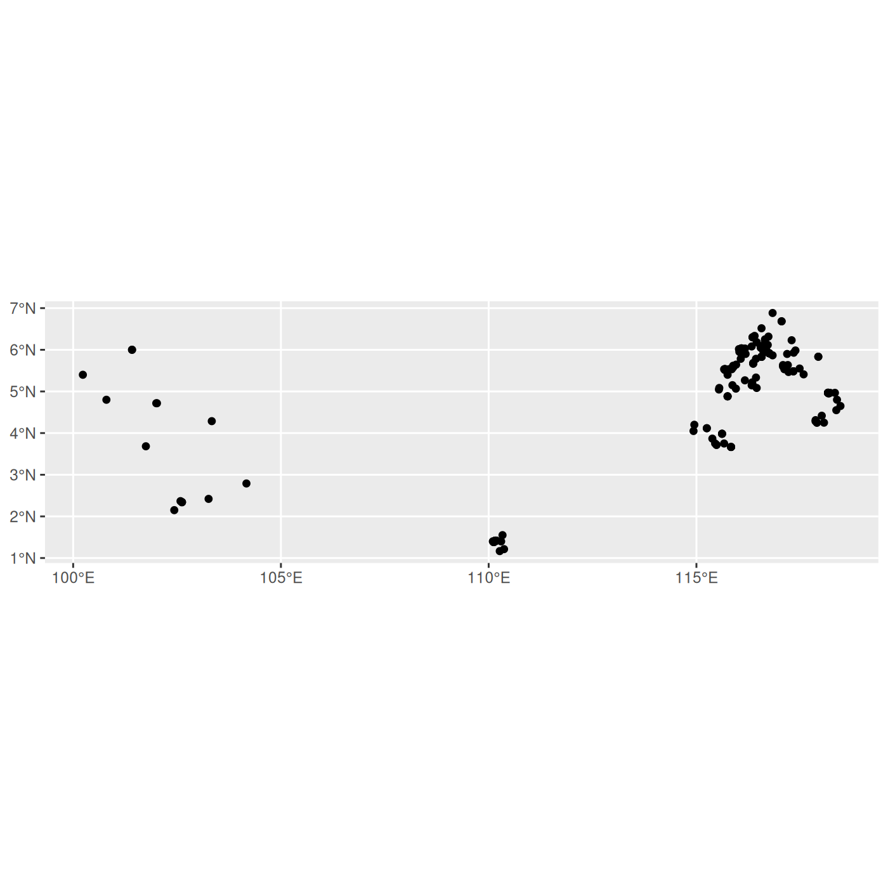
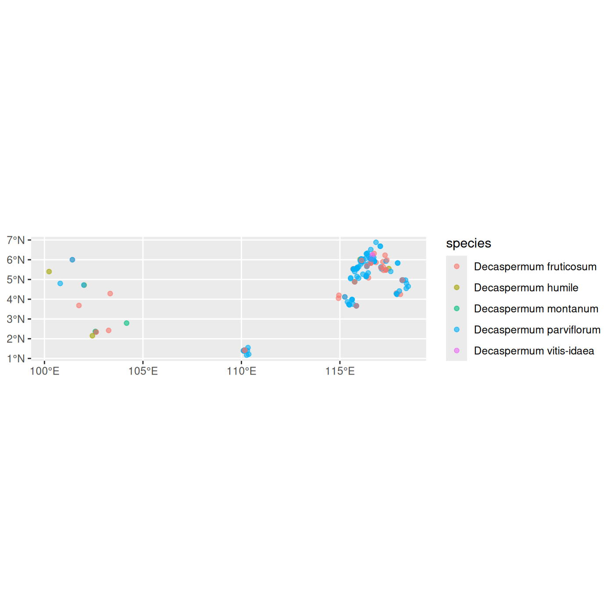
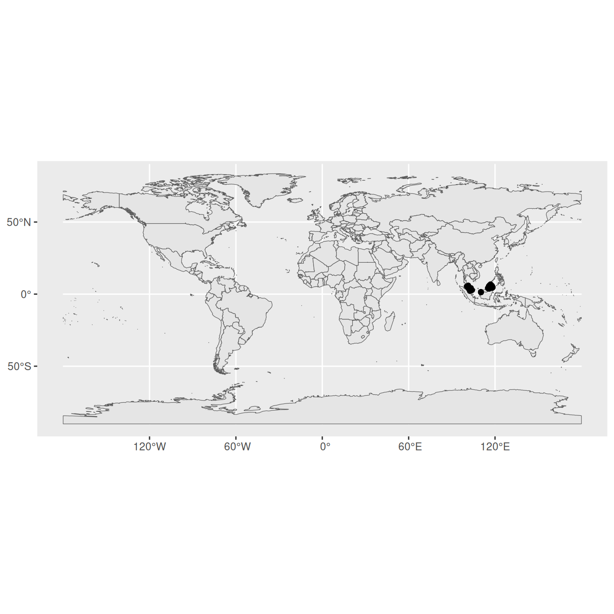
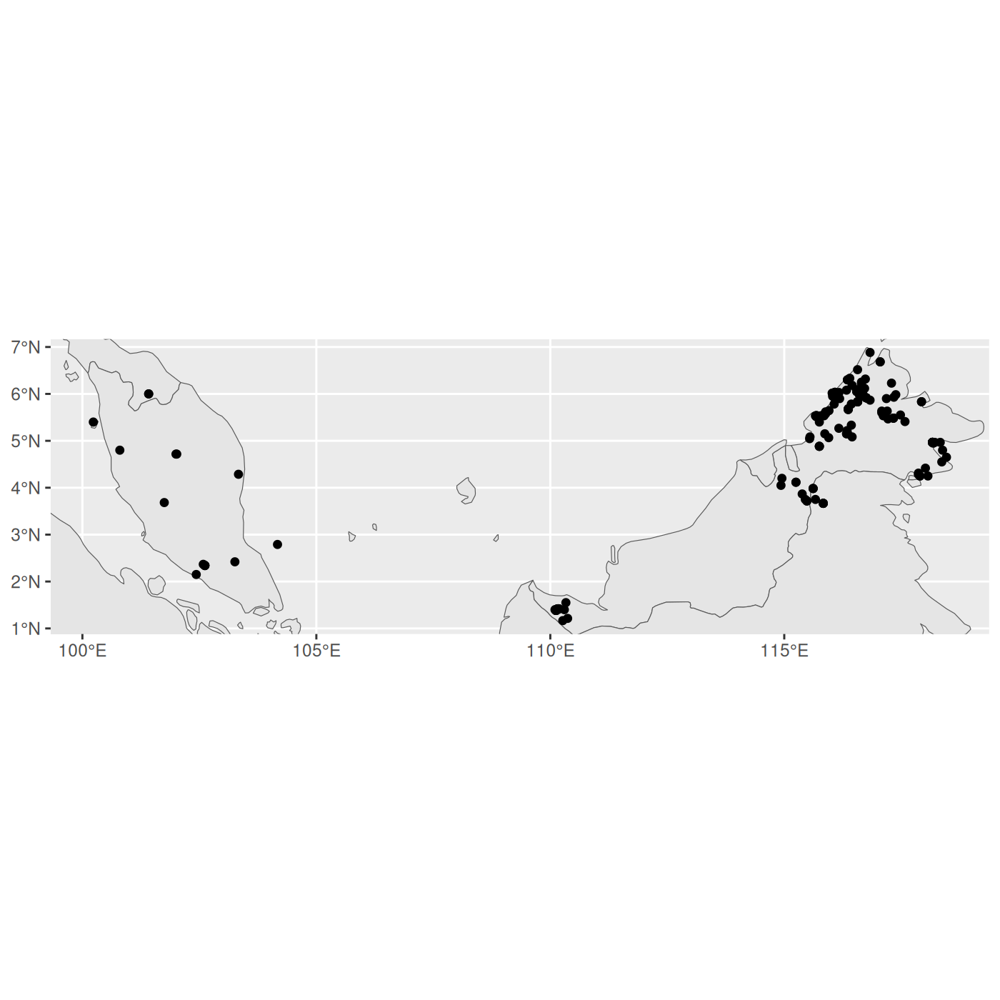
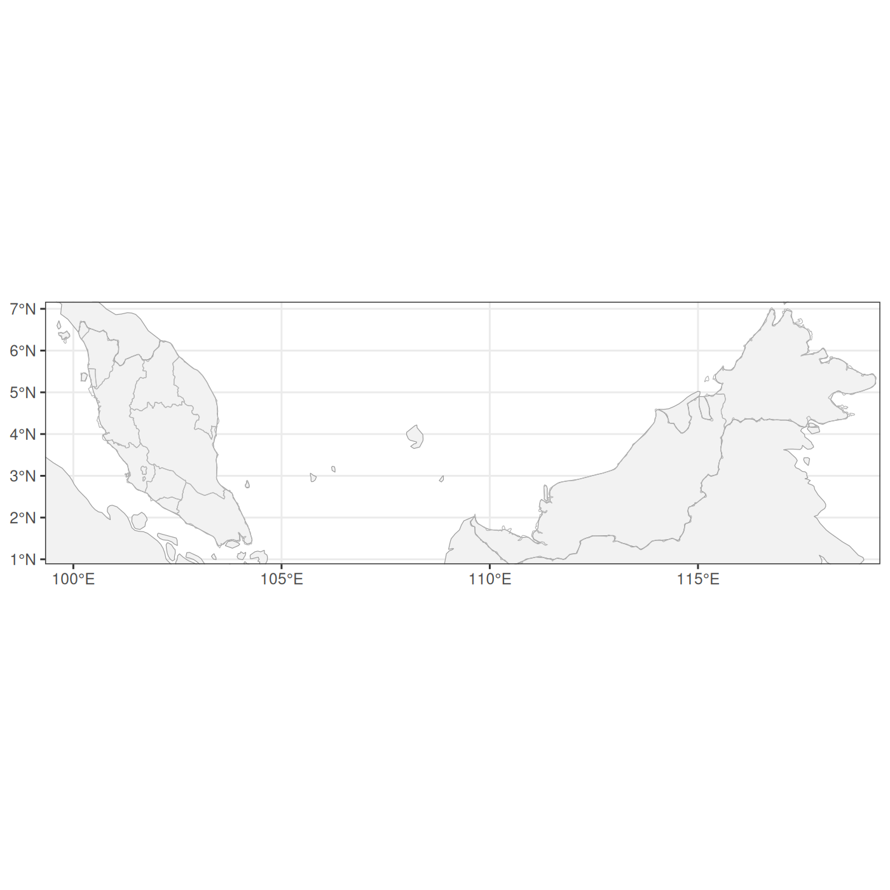
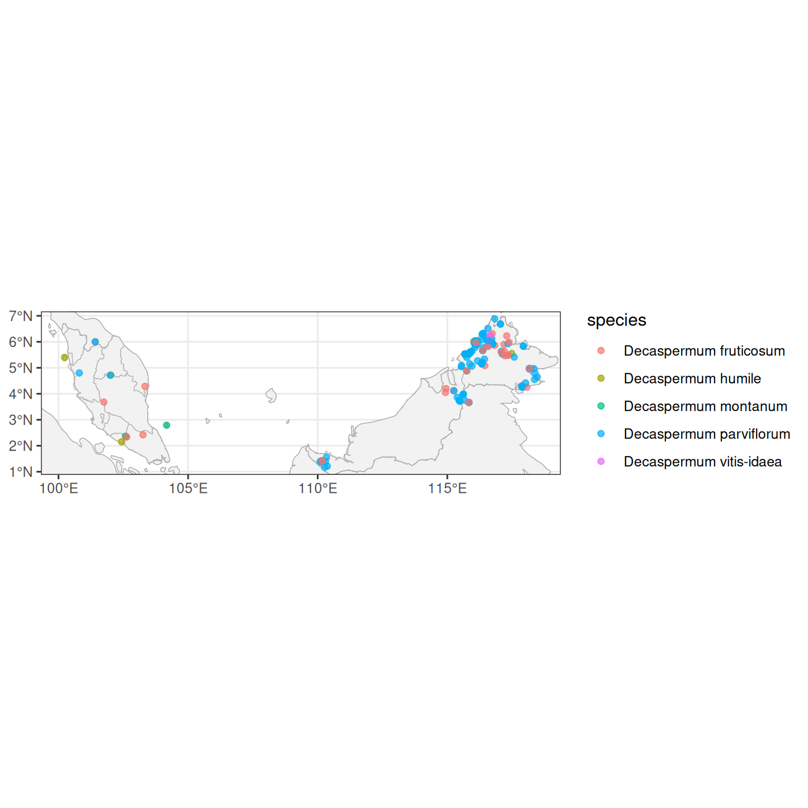
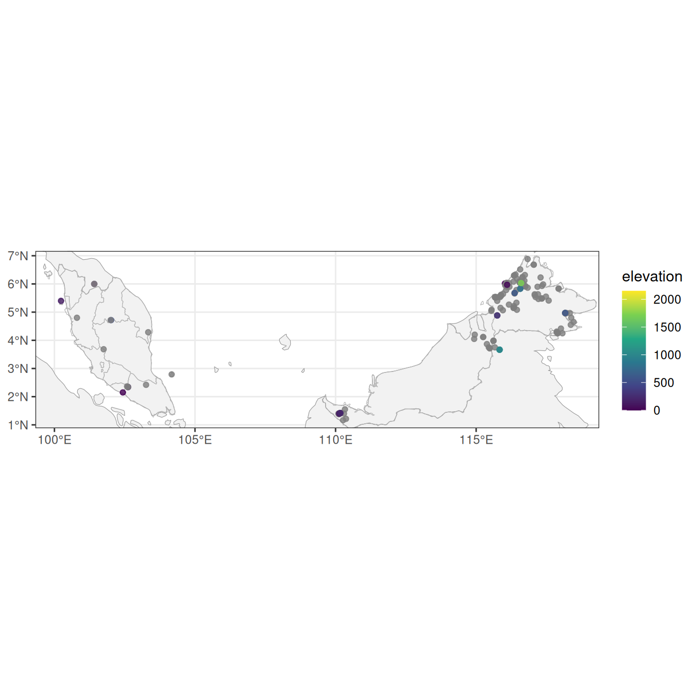
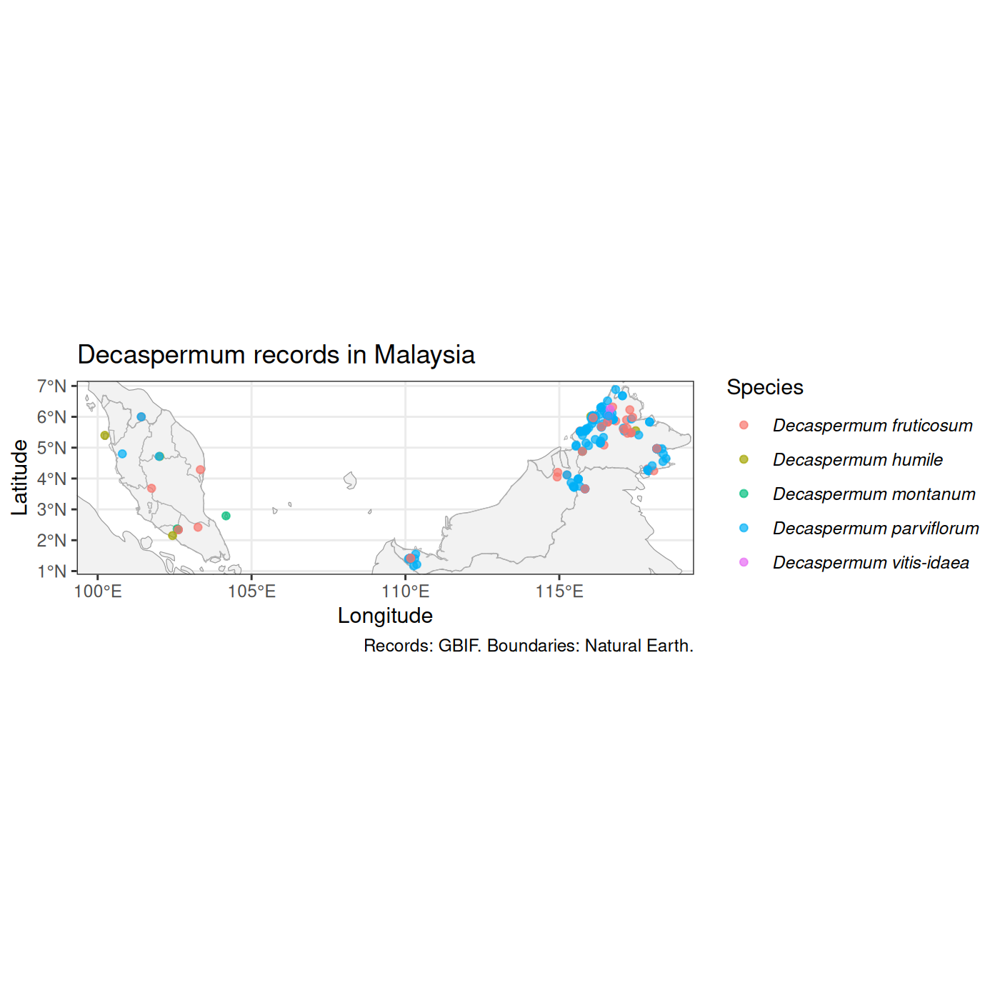
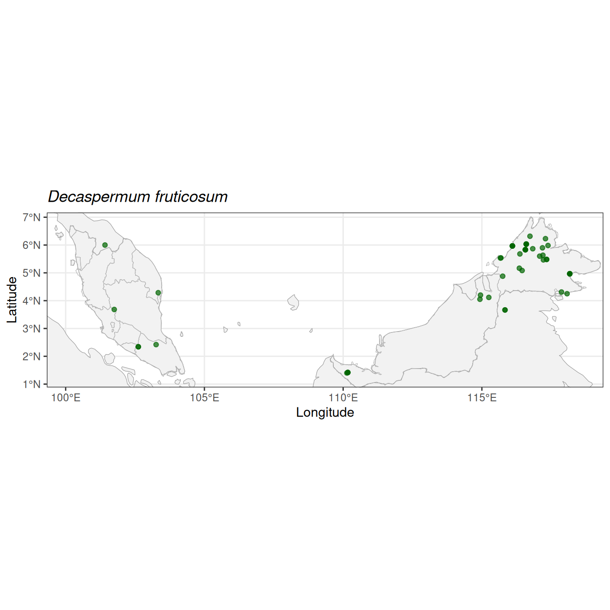
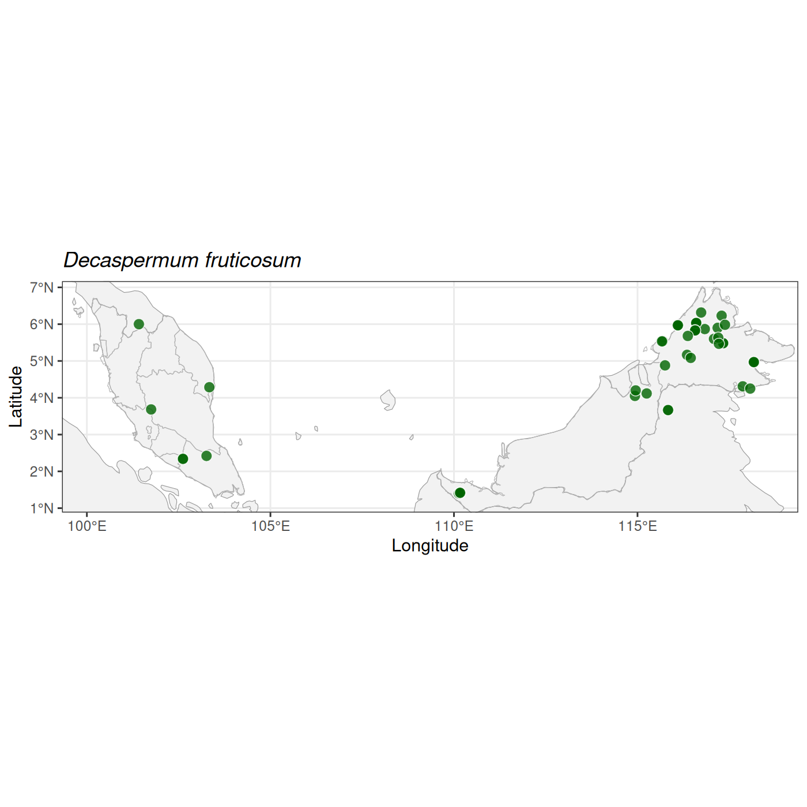

::::::::::::::::::::::::::::::::::::::: questions

- How do I turn latitude and longitude columns into spatial data?
- How can I add background maps to give my points context?
- How do I save a map, and make a separate map for each species?
- How do I make an interactive map?

::::::::::::::::::::::::::::::::::::::::::::::::::

::::::::::::::::::::::::::::::::::::::: objectives

- Convert a data frame with coordinates into an `sf` object
- Plot points and background maps with `geom_sf()`
- Add country and province boundaries from Natural Earth
- Save a map with `ggsave()`
- Use a `for` loop to make and save one map per species
- Build and customise an interactive map with `leaflet`

::::::::::::::::::::::::::::::::::::::::::::::::::

## Setting up


So far we have plotted our data as graphs of one variable against another. Our
`decaspermum_thin` data also contains the latitude and longitude of each record,
so we can plot it as a map. In this episode we will work with the `sf` package
(short for *simple features*), which lets R treat locations as spatial data, and
with `ggplot2` to draw the maps.

We need a few packages that we haven't used before. If you haven't already
installed them, run this once in the console:


``` r
install.packages(c("sf", "rnaturalearth", "rnaturalearthdata", "leaflet"))
```

Then load the packages we need. We also load `tidyverse` and `plantdat` again,
as in previous episodes.


``` r
library(tidyverse)
library(plantdat)
library(sf)
library(rnaturalearth)
library(leaflet)
```

::: instructor

The leaflet section at the end produces interactive maps, which appear in the
RStudio Viewer pane when learners run the code. They are not shown in the
website version of this lesson, so the code in that section is displayed but not
run. Consider demonstrating it live.

:::

## From coordinates to geometry

First, we are going to tidy up the data a little. We want to produce some species maps later on, but the `decaspermum_thin` data frame has some empty values in the  `species` column. We can create a new object called `decaspermum_sp` and use the `filter` function to ask for`species` that are not blank. The `!=` syntax means not equal to and the quote marks without any spaces means an empty value.   


``` r
decaspermum_sp <- decaspermum_thin |>
  dplyr::filter(species != "") 
```

Now let's look at the columns that hold the locations of our records.


``` r
decaspermum_sp |>
  select(species, decimalLatitude, decimalLongitude) |>
  head()
```

``` output
# A tibble: 6 × 3
  species                 decimalLatitude decimalLongitude
  <chr>                             <dbl>            <dbl>
1 Decaspermum fruticosum             6                101.
2 Decaspermum fruticosum             5.97             116.
3 Decaspermum fruticosum            NA                 NA 
4 Decaspermum fruticosum             4.97             118.
5 Decaspermum vitis-idaea            6.05             117.
6 Decaspermum montanum              NA                 NA 
```

To R, `decimalLatitude` and `decimalLongitude` are just two numeric columns. To
make a map, we need to tell R that together they define a **point** on the
Earth. This is what `st_as_sf()` does: it takes a data frame and adds a
`geometry` column that holds the location of each row.

Before we do that, we need to deal with missing values. Some records don't have
coordinates, and `st_as_sf()` will stop with an error if it finds any. Let's
check how many there are:


``` r
decaspermum_sp |>
  summarise(
    records = n(),
    missing_coords = sum(is.na(decimalLatitude) | is.na(decimalLongitude))
  )
```

``` output
# A tibble: 1 × 2
  records missing_coords
    <int>          <int>
1     797            590
```

We can't put a record on a map without coordinates, so we remove those rows with
`drop_na()` and then convert to an `sf` object:


``` r
decaspermum_sf <- decaspermum_sp |>
  drop_na(decimalLatitude, decimalLongitude) |>
  st_as_sf(coords = c("decimalLongitude", "decimalLatitude"),
           crs = 4326,
           remove = FALSE)

decaspermum_sf
```

``` output
Simple feature collection with 207 features and 13 fields
Geometry type: POINT
Dimension:     XY
Bounding box:  xmin: 100.2333 ymin: 1.16667 xmax: 118.4667 ymax: 6.88333
Geodetic CRS:  WGS 84
# A tibble: 207 × 14
       gbifID species      family stateProvince decimalLatitude decimalLongitude
 *      <dbl> <chr>        <chr>  <chr>                   <dbl>            <dbl>
 1 6561832516 Decaspermum… Myrta… Kelantan                 6                101.
 2 6561807785 Decaspermum… Myrta… Sabah                    5.97             116.
 3 6561766817 Decaspermum… Myrta… Sabah                    4.97             118.
 4 6561753311 Decaspermum… Myrta… Sabah                    6.05             117.
 5 6561508200 Decaspermum… Myrta… Sabah                    6.05             117.
 6 6561491291 Decaspermum… Myrta… Sabah                    5.83             117.
 7 6561379339 Decaspermum… Myrta… Sarawak                  3.67             116.
 8 6467128653 Decaspermum… Myrta… Sabah                    6.03             117.
 9 6433169320 Decaspermum… Myrta… Sabah                    6.02             116.
10 6000279575 Decaspermum… Myrta… Sabah                    5.97             116.
# ℹ 197 more rows
# ℹ 8 more variables: elevation <dbl>, year <int>, month <int>,
#   basisOfRecord <chr>, institutionCode <chr>, recordedBy <chr>,
#   license <chr>, geometry <POINT [°]>
```

There are three things to notice in this code:

- `coords` gives the names of the columns holding the coordinates. The order is
  **x first, then y**, which means longitude first, then latitude. This is easy
  to get the wrong way round.
- `crs = 4326` tells R which coordinate reference system the numbers use (see
  the box below).
- `remove = FALSE` keeps the original latitude and longitude columns as well as
  the new `geometry` column.

The output looks like our usual tibble, but with a header describing the
spatial data and a `geometry` column at the end.

::: callout

## What is a coordinate reference system?

Latitude and longitude describe positions on a globe, but maps are flat. A
**coordinate reference system (CRS)** is the set of rules that links numbers to
real positions on the Earth. Different CRSs are used for different purposes.

GBIF coordinates are in **WGS 84**, the system used by GPS, which has the
code `4326`. If you give `st_as_sf()` the wrong CRS, your points will be in the
wrong place on the map, so it is always worth checking what your data uses.

:::

::::: challenge
## Challenge 1: Missing coordinates

How many records were removed when we created `decaspermum_sf`? Check your
answer by comparing the number of rows in `decaspermum_thin` and
`decaspermum_sf`.

::: solution

``` r
nrow(decaspermum_sp) - nrow(decaspermum_sf)
```

``` output
[1] 590
```
:::

:::::

## Plotting points with `geom_sf()`

`ggplot2` knows how to draw `sf` objects. We use `geom_sf()` instead of
`geom_point()`, and we don't need to say which columns are x and y, because
`geom_sf()` finds the `geometry` column itself.


``` r
ggplot(data = decaspermum_sf) +
  geom_sf()
```



We can see the pattern of our records, but without any background it is hard to
tell where they are. As in earlier episodes, we can use `aes()` to colour the
points by species, and `alpha` to make overlapping points easier to see:


``` r
ggplot(data = decaspermum_sf) +
  geom_sf(aes(colour = species), alpha = 0.6)
```



## Adding background maps

To give the points context we need some boundaries underneath them. A good free
source is [Natural Earth](https://www.naturalearthdata.com/), which provides
public domain maps of countries, provinces, rivers and more. The
`rnaturalearth` package gives us direct access to the data from R.

We'll start with country boundaries:


``` r
countries <- ne_countries(scale = "medium", returnclass = "sf")
```

The `scale` argument sets how detailed the boundaries are. `"medium"` is a good
balance for a regional map. This object is also an `sf` object, with one row per
country and a `geometry` column containing the shape of each one.

Each `geom_sf()` layer can use its own data. We draw the countries first, then
the points on top:


``` r
ggplot() +
  geom_sf(data = countries) +
  geom_sf(data = decaspermum_sf)
```



Now we can see where our points are, but the whole world is shown and our
records are tiny. We want to zoom in. `coord_sf()` controls the area shown by
the map. We can get the extent of our points with `st_bbox()`. bb is short for bounding box and it creates four points that represent a rectangle, in this case that encloses all points in `decaspermum_thin`:


``` r
bbox <- st_bbox(decaspermum_sf)
bbox
```

``` output
     xmin      ymin      xmax      ymax 
100.23333   1.16667 118.46667   6.88333 
```

We can now use it to set the limits of the map. We will make a new object called `map_limits` and use the bbox coordinates with a function called `coord_sf`: 


``` r
map_limits <- coord_sf(xlim = c(bbox[["xmin"]], bbox[["xmax"]]),
                       ylim = c(bbox[["ymin"]], bbox[["ymax"]]))

ggplot() +
  geom_sf(data = countries) +
  geom_sf(data = decaspermum_sf) +
map_limits
```



### Adding province boundaries

Country outlines don't show much detail within Malaysia. Natural Earth also has
first-level administrative boundaries (states and provinces). We download these
with `ne_download()` and keep only Malaysia:


``` r
states <- ne_download(scale = 10,
                      type = "admin_1_states_provinces",
                      category = "cultural",
                      returnclass = "sf")

malaysia_states <- filter(states, admin == "Malaysia")
```

::: callout

## Downloading data

`ne_download()` fetches the file from the Natural Earth website, so you need an
internet connection and it can take a few seconds. If you are teaching or
learning somewhere with a poor connection, run this step beforehand.

:::

Now we can build up the map in layers. We will store the background layers in an
object called `base_map`, because we'll reuse it later. We also tidy up the look
with `theme_bw()`, and a pale grey fill so the points stand out. DOn't forget we need to add the `map_limits` to reframe the map. 


``` r
base_map <- ggplot() +
  geom_sf(data = countries, fill = "grey95", colour = "grey60") +
  geom_sf(data = malaysia_states, fill = NA, colour = "grey70", linewidth = 0.2) +
  theme_bw()

base_map  + map_limits
```



Because `base_map` is a `ggplot` object, we can add layers to it in the usual
way:


``` r
base_map +
  geom_sf(data = decaspermum_sf, aes(colour = species), alpha = 0.7) + 
  map_limits
```



::::: challenge
## Challenge 2: Change the points

Make a map where the points are coloured by `elevation` instead of `species`.
Use `scale_colour_viridis_c()` to give a continuous colour scale.

Why do you think some of the points are grey?

::: solution

``` r
base_map +
  geom_sf(data = decaspermum_sf, aes(colour = elevation), alpha = 0.8) +
  scale_colour_viridis_c() + 
  map_limits
```



The grey points are records where `elevation` is missing (`NA`), so they have no
value to map to a colour.
:::

:::::

## Customising and saving a map

Let's make a few small changes to our map: add a title and axis labels, credit
the data sources, and put the species names in italics as is the convention for
scientific names. We store the result in an object so we can save it.


``` r
species_map <- base_map +
  geom_sf(data = decaspermum_sf, aes(colour = species), alpha = 0.7) +
  labs(title = "Decaspermum records in Malaysia",
       x = "Longitude",
       y = "Latitude",
       colour = "Species",
       caption = "Records: GBIF. Boundaries: Natural Earth.") +
  theme(legend.text = element_text(face = "italic"))

species_map + map_limits
```



We save a plot with `ggsave()`. It takes a file name, the plot to save, and the
size of the image. The file type is chosen from the extension of the file name,
so `.png`, `.pdf` and `.svg` all work. First we'll create a folder to keep our
maps in:


``` r
dir.create("fig_output", showWarnings = FALSE)

ggsave(filename = "fig_output/decaspermum_map.png",
       plot = species_map,
       width = 8, height = 6, dpi = 300)
```

::: callout

## Choosing a file type and size

- **PNG** is a good general-purpose choice for slides and documents.
- **PDF** and **SVG** are vector formats that stay sharp at any size, which
  makes them good for posters and publications.
- `width` and `height` are in inches by default. Add `units = "cm"` to change
  that. A higher `dpi` gives a sharper image but a larger file.

If you don't give `ggsave()` a `plot`, it saves the last plot you displayed.
Naming the plot explicitly is safer.

:::

## Making a map for each species

At the moment, all species are on a single map. What if we want a separate map
for each one? We could copy and paste our code for every species, but that is
slow, and easy to get wrong. This is a job for a **loop**: a way of repeating
the same steps for each item in a list.

First, let's get the list of species. We use `st_drop_geometry()` to treat the
data as an ordinary table, then take the unique species names:


``` r
species_list <- decaspermum_sf |>
  st_drop_geometry() |>
  distinct(species) |>
  pull(species)

species_list
```

``` output
[1] "Decaspermum fruticosum"  "Decaspermum vitis-idaea"
[3] "Decaspermum humile"      "Decaspermum parviflorum"
[5] "Decaspermum montanum"   
```

Before writing the loop, let's work out the steps for just one species. We find the first species in the list with `species_list[1]` and filter occurrence data so that `sp` includes only the records for that species. Then we add `sp` to our base map, and give the map a title:


``` r
sp <- species_list[1]

sp_data <- decaspermum_sf |>
  filter(species == sp)

sp_map <- base_map +
  geom_sf(data = sp_data, colour = "darkgreen", alpha = 0.7) +
  labs(title = sp,
       x = "Longitude",
       y = "Latitude") +
  theme(plot.title = element_text(face = "italic"))

sp_map + map_limits
```



That is not bad, but as we are working in `ggplot` we have a lot of options that help us customise the map. For example, we can make the points a little larger, we can change the shape and add an outline in white. Let's plot the map again with new customised points. 


``` r
sp_map <- base_map +
geom_sf(data = sp_data,
        shape = 21,
        fill = "darkgreen",
        colour = "white",
        size = 3,
        stroke = 0.4,
        alpha = 0.8) +
  labs(title = sp,
       x = "Longitude",
       y = "Latitude") +
  theme(plot.title = element_text(face = "italic")) + 
  map_limits

sp_map
```



Great, that is better. 

Notice that because every map uses `base_map`, they all show the same area, so
the maps are easy to compare.

Now we can turn those steps into a loop. A `for` loop runs the code inside the
curly brackets once for each item in `species_list`, each time setting `sp` to
the next species name. At the end of each round we build a file name from the
species name and save the map:


``` r
for (sp in species_list) {

  sp_data <- decaspermum_sf |>
    filter(species == sp)

  sp_map <- base_map +
    geom_sf(data = sp_data,
            shape = 21,
            fill = "darkgreen",
            colour = "white",
            size = 3,
            stroke = 0.4,
            alpha = 0.8) +
    labs(title = sp,
         x = "Longitude",
         y = "Latitude") +
    theme(plot.title = element_text(face = "italic")) +
    map_limits

  file_name <- paste0("fig_output/", sp, ".png")

  ggsave(filename = file_name, plot = sp_map,
         width = 8, height = 6, dpi = 150)
}
```

Here `paste0()` joins the folder, the species name and the file extension into a
single file name, Let's check that the
files were created:


``` r
list.files("fig_output")
```

``` output
[1] "Decaspermum fruticosum.png"  "Decaspermum humile.png"     
[3] "Decaspermum montanum.png"    "Decaspermum parviflorum.png"
[5] "Decaspermum vitis-idaea.png" "decaspermum_map.png"        
```

::: callout

## Other ways to repeat things

A `for` loop is the most direct way to repeat steps, and is a good place to
start. You may come across other approaches:

- `purrr::walk()` does the same job as a `for` loop when you only want the side
  effect, such as saving a file.
- `facet_wrap(vars(species))` puts all the species on one image, as separate
  panels, instead of making separate files. This is the right choice when you want
  to compare species side by side on the same page.

:::

::::: challenge
## Challenge 3: Custom map
Now you can make a map in R using occurrence data!

Generate a new map of a single species and add some customisations. For example, you can try different options for the points (maybe you don't like green?!). You also know how to adjust the bounding box with `map_limits` - how would you make the map show a broader area, for example, to cover the whole of Borneo? 

Finally, explore the Natural Earth dataset. There may be more interesting layers to add to your map e.g. roads, parks and protected areas

:::::

## Interactive maps with leaflet

The maps we have made so far are static images. They are good for reports and
publications, but you can't zoom in or click on a point to find out more about
it. The `leaflet` package makes **interactive** maps that you can pan, zoom and
click.

::: callout

## Interactive maps in RStudio

Interactive maps appear in the **Viewer** pane of RStudio when you run the code,
so run the code in this section yourself to see them. They are not shown on this
website.

:::

<!-- TODO: add screenshots of each stage of the map to episodes/fig/ and link them here -->

A leaflet map is built up in the same way as a `ggplot`, but with the pipe (`|>`)
rather than `+`. We give `leaflet()` our data, add a background map with
`addTiles()`, and then add our points with `addCircleMarkers()`:


``` r
leaflet(decaspermum_sf) |>
  addTiles() |>
  addCircleMarkers()
```

<!--html_preserve--><div class="leaflet html-widget html-fill-item" id="htmlwidget-bd14972c38dc6f72522a" style="width:600px;height:600px;"></div>
<script type="application/json" data-for="htmlwidget-bd14972c38dc6f72522a">{"x":{"options":{"crs":{"crsClass":"L.CRS.EPSG3857","code":null,"proj4def":null,"projectedBounds":null,"options":{}}},"calls":[{"method":"addTiles","args":["https://{s}.tile.openstreetmap.org/{z}/{x}/{y}.png",null,null,{"minZoom":0,"maxZoom":18,"tileSize":256,"subdomains":"abc","errorTileUrl":"","tms":false,"noWrap":false,"zoomOffset":0,"zoomReverse":false,"opacity":1,"zIndex":1,"detectRetina":false,"attribution":"&copy; <a href=\"https://openstreetmap.org/copyright/\">OpenStreetMap<\/a>,  <a href=\"https://opendatacommons.org/licenses/odbl/\">ODbL<\/a>"}]},{"method":"addCircleMarkers","args":[[6,5.966667,4.966667,6.05,6.05,5.833333,3.666667,6.033333,6.016389,5.966667,6.033333,6.05,6.05,6.05,6.05,6.05,2.339833,2.420278,5.833334,4.966667,3.666667,5.966667,6.033333,3.666667,5.973056,1.416667,1.416667,4.116667,1.383333,1.405555,2.790236,6.05,4.28639,4.310944,4.8833,5.55,2.3442,3.6833,4.7167,4.8,4.25,2.36667,6.03333,6.05,5.4,5.4834,6.05,6.33333,6.21667,1.41667,3.98333,1.41667,5.15,6.88333,4.11667,6.3,5.16667,5.5375,6.08333,1.16667,5.9167,1.4,5.96667,1.41667,5.61667,1.21388,5.5333,4.8,4.96667,4.96667,5.95417,6.03333,1.41667,5.58333,6.05,1.41667,1.4,5.98333,5.93333,1.41667,3.71667,6.08333,6,5.9,5.78333,5.33333,5.83333,4.25,5.98333,5.08333,5.86667,6.03333,6.11667,3.75,5.9167,5.41,5.56667,6.68333,5.9,6.05,4.96667,5.96667,6.03333,5.83333,6.51667,5.4834,6,1.41667,6.05,5.53333,6.68333,5.96667,5.68333,6.18333,4.25,5.4834,1.4,6.22917,5.9,6.05,1.4,4.71667,1.38333,6.05,2.33983,5.96667,5.83333,4.96667,6.05,3.98333,5.26667,5.15,6.08,5.53333,5.64333,6.05,4.88333,5.9167,5.15,5.96667,3.98333,4.96667,5.78333,5.9167,5.5375,6.05,1.38333,5.04583,6.31667,5.66667,6.03333,4.28333,4.95,5.58333,1.41667,6.3,1.4,5.51667,5.92917,5.96667,3.75,4.65,5.9167,5.9,5.63333,6.08333,6.05,4.41667,4.05,5.6,5.63333,5.9167,5.51667,6.05,4.96667,5.06667,5.4667,6.03333,4.2,6.03333,5.08333,6.03,5.21667,5.58333,4.55,1.55,5.58333,6.25,5.95,3.86667,5.98333,3.71667,5.66667,5.53333,2.15,5.4,1.4,5.83,6.03,1.42,4.88,5.68,5.97,4.97,1.4056,1.416667,3.666],[101.416667,116.1,118.166667,116.6,116.6,116.566667,115.833333,116.6,116.023056,116.1,116.6,116.6,116.6,116.6,116.616667,116.6,102.617833,103.259167,116.566667,118.166667,115.833334,116.1,116.6,115.833334,116.631666,110.166667,110.166667,115.25,110.116667,110.133055,104.169909,116.616667,103.33583,117.867861,115.75,117.483333,102.6186,101.75,102.0167,100.8,117.9,102.58333,116.6,116.6,115.75,117.33333,116.55,116.4,116.65,110.18333,115.61667,110.16667,115.86667,116.83333,115.25,116.35,116.35,115.6875,116.54583,110.26667,116.75,110.3,116.61667,110.18333,115.88333,110.37015,115.85,118.38333,118.16667,118.33333,116.67083,116.08333,110.15,115.88333,116.6,110.16667,110.13333,116.68333,116.06667,110.16667,115.48333,116.55,101.41667,116.18333,116.06667,116.43333,117.93333,117.9,116.65,116.45,116.83333,116.66667,116.71667,115.45,116.75,117.58,115.86667,117.05,117.18333,116.6,118.21667,116.61667,116.6,117.93333,116.56667,117.33333,116.63333,110.18333,116.55,115.66667,117.05,116.61667,116.36667,116.45,118.07,117.33333,110.1,117.29167,116.1,116.6,110.13333,102,110.11667,116.6,102.61783,116.1,116.56667,118.16667,116.6,115.61667,116.16667,116.33,116.33,117.11667,115.95611,116.6,115.75,116.75,116.33333,116.68333,115.61667,118.16667,116.43333,116.75,115.6875,116.6,110.13333,115.54167,116.73333,116.36667,116.08333,117.86667,118.18333,115.88333,110.15,116.35,110.13333,115.68333,117.34167,116.61667,115.66667,118.46667,116.75,116.1,117.08333,116.54583,116.55,118.01667,114.93,117.08333,117.2,116.75,115.68333,116.6,118.16667,115.95,117.21671,116.08333,114.95,116.08333,115.55,116.17,116.34167,115.87083,118.36667,110.33333,115.88333,116.65,116.03333,115.38333,117.38333,115.48333,116.36667,115.78333,102.433333,100.233333,110.133333,116.57,116.6,110.17,115.75,116.37,116.1,118.17,110.1331,110.166667,115.833],10,null,null,{"interactive":true,"className":"","stroke":true,"color":"#03F","weight":5,"opacity":0.5,"fill":true,"fillColor":"#03F","fillOpacity":0.2},null,null,null,null,null,{"interactive":false,"permanent":false,"direction":"auto","opacity":1,"offset":[0,0],"textsize":"10px","textOnly":false,"className":"","sticky":true},null]}],"limits":{"lat":[1.16667,6.88333],"lng":[100.233333,118.46667]}},"evals":[],"jsHooks":[]}</script><!--/html_preserve-->

<iframe src="files/leaflet-basic.html" width="100%" height="500"
        style="border: 0;" title="Interactive map of Decaspermum records"></iframe>

Cool, your first interactive map!

Because our data is an `sf` object, `leaflet` finds the points in the `geometry`
column without being told. The background map comes from OpenStreetMap, and you
can zoom in until you reach street level.

### Customising the points

Many of the arguments of `addCircleMarkers()` will look familiar. Let's make some adjustments with smaller points and a white outline:


``` r
leaflet(decaspermum_sf) |>
  addTiles() |>
  addCircleMarkers(radius = 5,
                   stroke = TRUE,
                   color = "white",
                   weight = 1,
                   opacity = 1,
                   fill = TRUE,
                   fillColor = "blue",
                   fillOpacity = 0.8)
```

<iframe src="files/leaflet_points.html" width="100%" height="500"
        style="border: 0;" title="Interactive map of Decaspermum records"></iframe>

### Adding labels and popups

A `label` appears when you hover over a point, and a `popup` appears when you
click on it. To use data from a column, we put a `~` (tilde) in front of the
column name. For a popup, we can build a longer message by using `paste0()` and
some HTML tags (`<b>` for bold and `<br>` for a new line):


``` r
leaflet(decaspermum_sf) |>
  addTiles() |>
  addCircleMarkers(radius = 5,
                   stroke = TRUE,
                   color = "white",
                   weight = 1,
                   opacity = 1,
                   fill = TRUE,
                   fillColor = "blue",
                   fillOpacity = 0.8,
                   label = ~species,
                   popup = ~paste0("<b>", species, "</b><br>",
                                   "Elevation: ", elevation, " m<br>",
                                   "Year: ", year, "<br>",
                                   "Collector: ", recordedBy))
```

<!--html_preserve--><div class="leaflet html-widget html-fill-item" id="htmlwidget-498d8a1d295d6167436b" style="width:600px;height:600px;"></div>
<script type="application/json" data-for="htmlwidget-498d8a1d295d6167436b">{"x":{"options":{"crs":{"crsClass":"L.CRS.EPSG3857","code":null,"proj4def":null,"projectedBounds":null,"options":{}}},"calls":[{"method":"addTiles","args":["https://{s}.tile.openstreetmap.org/{z}/{x}/{y}.png",null,null,{"minZoom":0,"maxZoom":18,"tileSize":256,"subdomains":"abc","errorTileUrl":"","tms":false,"noWrap":false,"zoomOffset":0,"zoomReverse":false,"opacity":1,"zIndex":1,"detectRetina":false,"attribution":"&copy; <a href=\"https://openstreetmap.org/copyright/\">OpenStreetMap<\/a>,  <a href=\"https://opendatacommons.org/licenses/odbl/\">ODbL<\/a>"}]},{"method":"addCircleMarkers","args":[[6,5.966667,4.966667,6.05,6.05,5.833333,3.666667,6.033333,6.016389,5.966667,6.033333,6.05,6.05,6.05,6.05,6.05,2.339833,2.420278,5.833334,4.966667,3.666667,5.966667,6.033333,3.666667,5.973056,1.416667,1.416667,4.116667,1.383333,1.405555,2.790236,6.05,4.28639,4.310944,4.8833,5.55,2.3442,3.6833,4.7167,4.8,4.25,2.36667,6.03333,6.05,5.4,5.4834,6.05,6.33333,6.21667,1.41667,3.98333,1.41667,5.15,6.88333,4.11667,6.3,5.16667,5.5375,6.08333,1.16667,5.9167,1.4,5.96667,1.41667,5.61667,1.21388,5.5333,4.8,4.96667,4.96667,5.95417,6.03333,1.41667,5.58333,6.05,1.41667,1.4,5.98333,5.93333,1.41667,3.71667,6.08333,6,5.9,5.78333,5.33333,5.83333,4.25,5.98333,5.08333,5.86667,6.03333,6.11667,3.75,5.9167,5.41,5.56667,6.68333,5.9,6.05,4.96667,5.96667,6.03333,5.83333,6.51667,5.4834,6,1.41667,6.05,5.53333,6.68333,5.96667,5.68333,6.18333,4.25,5.4834,1.4,6.22917,5.9,6.05,1.4,4.71667,1.38333,6.05,2.33983,5.96667,5.83333,4.96667,6.05,3.98333,5.26667,5.15,6.08,5.53333,5.64333,6.05,4.88333,5.9167,5.15,5.96667,3.98333,4.96667,5.78333,5.9167,5.5375,6.05,1.38333,5.04583,6.31667,5.66667,6.03333,4.28333,4.95,5.58333,1.41667,6.3,1.4,5.51667,5.92917,5.96667,3.75,4.65,5.9167,5.9,5.63333,6.08333,6.05,4.41667,4.05,5.6,5.63333,5.9167,5.51667,6.05,4.96667,5.06667,5.4667,6.03333,4.2,6.03333,5.08333,6.03,5.21667,5.58333,4.55,1.55,5.58333,6.25,5.95,3.86667,5.98333,3.71667,5.66667,5.53333,2.15,5.4,1.4,5.83,6.03,1.42,4.88,5.68,5.97,4.97,1.4056,1.416667,3.666],[101.416667,116.1,118.166667,116.6,116.6,116.566667,115.833333,116.6,116.023056,116.1,116.6,116.6,116.6,116.6,116.616667,116.6,102.617833,103.259167,116.566667,118.166667,115.833334,116.1,116.6,115.833334,116.631666,110.166667,110.166667,115.25,110.116667,110.133055,104.169909,116.616667,103.33583,117.867861,115.75,117.483333,102.6186,101.75,102.0167,100.8,117.9,102.58333,116.6,116.6,115.75,117.33333,116.55,116.4,116.65,110.18333,115.61667,110.16667,115.86667,116.83333,115.25,116.35,116.35,115.6875,116.54583,110.26667,116.75,110.3,116.61667,110.18333,115.88333,110.37015,115.85,118.38333,118.16667,118.33333,116.67083,116.08333,110.15,115.88333,116.6,110.16667,110.13333,116.68333,116.06667,110.16667,115.48333,116.55,101.41667,116.18333,116.06667,116.43333,117.93333,117.9,116.65,116.45,116.83333,116.66667,116.71667,115.45,116.75,117.58,115.86667,117.05,117.18333,116.6,118.21667,116.61667,116.6,117.93333,116.56667,117.33333,116.63333,110.18333,116.55,115.66667,117.05,116.61667,116.36667,116.45,118.07,117.33333,110.1,117.29167,116.1,116.6,110.13333,102,110.11667,116.6,102.61783,116.1,116.56667,118.16667,116.6,115.61667,116.16667,116.33,116.33,117.11667,115.95611,116.6,115.75,116.75,116.33333,116.68333,115.61667,118.16667,116.43333,116.75,115.6875,116.6,110.13333,115.54167,116.73333,116.36667,116.08333,117.86667,118.18333,115.88333,110.15,116.35,110.13333,115.68333,117.34167,116.61667,115.66667,118.46667,116.75,116.1,117.08333,116.54583,116.55,118.01667,114.93,117.08333,117.2,116.75,115.68333,116.6,118.16667,115.95,117.21671,116.08333,114.95,116.08333,115.55,116.17,116.34167,115.87083,118.36667,110.33333,115.88333,116.65,116.03333,115.38333,117.38333,115.48333,116.36667,115.78333,102.433333,100.233333,110.133333,116.57,116.6,110.17,115.75,116.37,116.1,118.17,110.1331,110.166667,115.833],5,null,null,{"interactive":true,"className":"","stroke":true,"color":"white","weight":1,"opacity":1,"fill":true,"fillColor":"blue","fillOpacity":0.8},null,null,["<b>Decaspermum fruticosum<\/b><br>Elevation: 75 m<br>Year: 1990<br>Collector: Engkik Soepadmo;M. Suhaimi","<b>Decaspermum fruticosum<\/b><br>Elevation: 25 m<br>Year: 1984<br>Collector: John H. Beaman;Teofila E. Beaman","<b>Decaspermum fruticosum<\/b><br>Elevation: 575 m<br>Year: 1984<br>Collector: John H. Beaman;Reed S. Beaman;Teofila E. Beaman;Pamla Decker","<b>Decaspermum vitis-idaea<\/b><br>Elevation: 2025 m<br>Year: 1983<br>Collector: John H. Beaman;Reed S. Beaman;K. Medley;T. Lawrence Mellichamp","<b>Decaspermum vitis-idaea<\/b><br>Elevation: 2025 m<br>Year: 1984<br>Collector: John H. Beaman;John T. Atwood;Reed S. Beaman;Teofila E. Beaman;Elizabeth L. Besse;Pamla Decker","<b>Decaspermum fruticosum<\/b><br>Elevation: 800 m<br>Year: 1984<br>Collector: John H. Beaman;Reed S. Beaman;Teofila E. Beaman;Eric A. Christenson;Pamla Decker","<b>Decaspermum fruticosum<\/b><br>Elevation: 1000 m<br>Year: 1992<br>Collector: Hanne Christensen;F.L. Apu","<b>Decaspermum fruticosum<\/b><br>Elevation: 1720 m<br>Year: 1984<br>Collector: Beaman, John H.; Perkins, David","<b>Decaspermum humile<\/b><br>Elevation: 3 m<br>Year: 1954<br>Collector: Wood, G.H.S.;Wyatt-Smith, J.","<b>Decaspermum fruticosum<\/b><br>Elevation: 25 m<br>Year: 1984<br>Collector: John H. Beaman","<b>Decaspermum fruticosum<\/b><br>Elevation: 1720 m<br>Year: 1984<br>Collector: John H. Beaman","<b>Decaspermum vitis-idaea<\/b><br>Elevation: 1800 m<br>Year: 1983<br>Collector: Beaman, J.H.; Beaman, R.S.; Medley, K.; Mellichamp, T.L.","<b>Decaspermum vitis-idaea<\/b><br>Elevation: 2025 m<br>Year: 1983<br>Collector: Beaman, J.H.; Beaman, R.S.; Medley, K.; Mellichamp, T.L.","<b>Decaspermum vitis-idaea<\/b><br>Elevation: 2025 m<br>Year: 1984<br>Collector: Beaman, J.H.; Atwood, J.T.; Beaman, R.S.; Beaman, T.E.; Besse, L.; Decker, P.","<b>Decaspermum vitis-idaea<\/b><br>Elevation: 1900 m<br>Year: 1995<br>Collector: Beaman, J.H.; Beaman, R.; Beaman, T.E.; Anderson, C.","<b>Decaspermum vitis-idaea<\/b><br>Elevation: 2150 m<br>Year: 1984<br>Collector: Beaman, J.H.; Beaman, R.S.; Decker, P.; Sutton, B.","<b>Decaspermum parviflorum<\/b><br>Elevation: 166 m<br>Year: 2013<br>Collector: Chew, M.Y.; Kueh, H.L.","<b>Decaspermum fruticosum<\/b><br>Elevation: NA m<br>Year: 2004<br>Collector: K.M. Wong; M.S. Zahid","<b>Decaspermum fruticosum<\/b><br>Elevation: 800 m<br>Year: 1984<br>Collector: Beaman, J.H.; Beaman, R.S.; Beaman, T.E.; Christenson, E.A.; Decker, P.","<b>Decaspermum fruticosum<\/b><br>Elevation: 575 m<br>Year: 1984<br>Collector: Beaman, J.H.; Beaman, R.S.; Beaman, T.E.; Decker, P.","<b>Decaspermum parviflorum<\/b><br>Elevation: 1000 m<br>Year: 1992<br>Collector: Christensen, H.; Apu, F.L.","<b>Decaspermum fruticosum<\/b><br>Elevation: 25 m<br>Year: 1984<br>Collector: Beaman, J.H.; Beaman, T.E.","<b>Decaspermum parviflorum<\/b><br>Elevation: 1720 m<br>Year: 1984<br>Collector: Beaman, J.H.; Perkins, D.","<b>Decaspermum parviflorum<\/b><br>Elevation: 1000 m<br>Year: 1992<br>Collector: Christensen, H.; Apu, F.L.","<b>Decaspermum parviflorum<\/b><br>Elevation: NA m<br>Year: 1992<br>Collector: Doinis Soibeh","<b>Decaspermum parviflorum<\/b><br>Elevation: NA m<br>Year: 1963<br>Collector: Chew Wee-Lek","<b>Decaspermum fruticosum<\/b><br>Elevation: NA m<br>Year: 1963<br>Collector: Chew Wee-Lek","<b>Decaspermum fruticosum<\/b><br>Elevation: NA m<br>Year: NA<br>Collector: Anderson, J.A.R.","<b>Decaspermum parviflorum<\/b><br>Elevation: 100 m<br>Year: 1996<br>Collector: Beaman, J.H.; Cheek, M.; Beaman, T.E.","<b>Decaspermum parviflorum<\/b><br>Elevation: 100 m<br>Year: 1996<br>Collector: Beaman, J.H.; Cheek, M.; Beaman, T.E.","<b>Decaspermum montanum<\/b><br>Elevation: NA m<br>Year: 1927<br>Collector: Nur, MD.","<b>Decaspermum vitis-idaea<\/b><br>Elevation: NA m<br>Year: 1995<br>Collector: John H. Beaman","<b>Decaspermum fruticosum<\/b><br>Elevation: NA m<br>Year: 2014<br>Collector: Kamarul Hisham M; Yao TL; Chew MY","<b>Decaspermum fruticosum<\/b><br>Elevation: NA m<br>Year: 1993<br>Collector: A Berhaman","<b>Decaspermum humile<\/b><br>Elevation: 300 m<br>Year: 1969<br>Collector: Nooteboom, H.P.","<b>Decaspermum humile<\/b><br>Elevation: NA m<br>Year: 2010<br>Collector: Wilson, Peter G.;Berhaman, A.;Postar, J.M.","<b>Decaspermum fruticosum<\/b><br>Elevation: 166 m<br>Year: 2013<br>Collector: Chew, M.Y.","<b>Decaspermum fruticosum<\/b><br>Elevation: NA m<br>Year: 2007<br>Collector: Syahida Emiza, S.","<b>Decaspermum humile<\/b><br>Elevation: 520 m<br>Year: 1996<br>Collector: Saw, L.G.","<b>Decaspermum parviflorum<\/b><br>Elevation: NA m<br>Year: NA<br>Collector: Scortechini B","<b>Decaspermum parviflorum<\/b><br>Elevation: NA m<br>Year: 1922<br>Collector: Elmer ADE","<b>Decaspermum montanum<\/b><br>Elevation: NA m<br>Year: 1996<br>Collector: Balgooy MMJ van","<b>Decaspermum fruticosum<\/b><br>Elevation: NA m<br>Year: 1984<br>Collector: Beaman JH; Perkins D","<b>Decaspermum vitis-idaea<\/b><br>Elevation: NA m<br>Year: 1983<br>Collector: Beaman JH; Beaman RS; Medley K; Mellichamp TL","<b>Decaspermum parviflorum<\/b><br>Elevation: NA m<br>Year: 1973<br>Collector: Sundaling D; Abdul Karim Momin","<b>Decaspermum parviflorum<\/b><br>Elevation: NA m<br>Year: 1988<br>Collector: Sundaling D; et al.","<b>Decaspermum vitis-idaea<\/b><br>Elevation: NA m<br>Year: 1964<br>Collector: Poore MED","<b>Decaspermum parviflorum<\/b><br>Elevation: NA m<br>Year: 1936<br>Collector: Kandilis","<b>Decaspermum vitis-idaea<\/b><br>Elevation: NA m<br>Year: 1961<br>Collector: Meijer W","<b>Decaspermum parviflorum<\/b><br>Elevation: NA m<br>Year: 1977<br>Collector: Lee Meng Hock B","<b>Decaspermum parviflorum<\/b><br>Elevation: NA m<br>Year: 1955<br>Collector: Brooke WMA","<b>Decaspermum parviflorum<\/b><br>Elevation: NA m<br>Year: 1960<br>Collector: Anderson JAR","<b>Decaspermum parviflorum<\/b><br>Elevation: NA m<br>Year: 1968<br>Collector: Kokawa S; Hotta M","<b>Decaspermum parviflorum<\/b><br>Elevation: NA m<br>Year: 1935<br>Collector: Valera J","<b>Decaspermum parviflorum<\/b><br>Elevation: NA m<br>Year: 1971<br>Collector: Anderson JAR","<b>Decaspermum parviflorum<\/b><br>Elevation: NA m<br>Year: 1963<br>Collector: John Kuripin Lajangah","<b>Decaspermum fruticosum<\/b><br>Elevation: NA m<br>Year: 1976<br>Collector: Nordin AA; Sundaling D","<b>Decaspermum fruticosum<\/b><br>Elevation: NA m<br>Year: 1984<br>Collector: Sigun AA; Heya  Abu Bakar","<b>Decaspermum vitis-idaea<\/b><br>Elevation: NA m<br>Year: 1933<br>Collector: Clemens J; Clemens MS","<b>Decaspermum parviflorum<\/b><br>Elevation: NA m<br>Year: 1975<br>Collector: Ismawi O","<b>Decaspermum parviflorum<\/b><br>Elevation: NA m<br>Year: 1987<br>Collector: Sigun AA; Francis A","<b>Decaspermum parviflorum<\/b><br>Elevation: NA m<br>Year: 1963<br>Collector: Quisumbing E","<b>Decaspermum parviflorum<\/b><br>Elevation: NA m<br>Year: 1969<br>Collector: Kokawa S; Hotta M","<b>Decaspermum parviflorum<\/b><br>Elevation: NA m<br>Year: 1960<br>Collector: Anderson JAR","<b>Decaspermum parviflorum<\/b><br>Elevation: NA m<br>Year: 1948<br>Collector: Han AR","<b>Decaspermum parviflorum<\/b><br>Elevation: NA m<br>Year: 1973<br>Collector: Mamit JD","<b>Decaspermum parviflorum<\/b><br>Elevation: NA m<br>Year: 1948<br>Collector: Han AR","<b>Decaspermum parviflorum<\/b><br>Elevation: NA m<br>Year: 1961<br>Collector: Chai Muin","<b>Decaspermum parviflorum<\/b><br>Elevation: NA m<br>Year: 1986<br>Collector: Dransfield J","<b>Decaspermum parviflorum<\/b><br>Elevation: NA m<br>Year: 1959<br>Collector: Meijer W","<b>Decaspermum parviflorum<\/b><br>Elevation: NA m<br>Year: 1954<br>Collector: Darnton S","<b>Decaspermum parviflorum<\/b><br>Elevation: NA m<br>Year: 1961<br>Collector: Singh J","<b>Decaspermum parviflorum<\/b><br>Elevation: NA m<br>Year: 1955<br>Collector: Brooke WMA","<b>Decaspermum parviflorum<\/b><br>Elevation: NA m<br>Year: 1987<br>Collector: Sigun AA","<b>Decaspermum vitis-idaea<\/b><br>Elevation: NA m<br>Year: 1964<br>Collector: Chew W-L; Corner EJH","<b>Decaspermum parviflorum<\/b><br>Elevation: NA m<br>Year: 1963<br>Collector: Chew W-L","<b>Decaspermum parviflorum<\/b><br>Elevation: NA m<br>Year: 1976<br>Collector: Mamit JD; et al.","<b>Decaspermum parviflorum<\/b><br>Elevation: NA m<br>Year: 1987<br>Collector: Sigun AA; et al.","<b>Decaspermum parviflorum<\/b><br>Elevation: NA m<br>Year: 1988<br>Collector: Sigun AA","<b>Decaspermum parviflorum<\/b><br>Elevation: NA m<br>Year: 1963<br>Collector: Chew W-L","<b>Decaspermum parviflorum<\/b><br>Elevation: NA m<br>Year: 1970<br>Collector: Nooteboom HP; Chai PPK","<b>Decaspermum vitis-idaea<\/b><br>Elevation: NA m<br>Year: 1933<br>Collector: Clemens J; Clemens MS","<b>Decaspermum parviflorum<\/b><br>Elevation: NA m<br>Year: 1990<br>Collector: Soepadmo E; Suhaimi M","<b>Decaspermum parviflorum<\/b><br>Elevation: NA m<br>Year: 1973<br>Collector: Sundaling D","<b>Decaspermum parviflorum<\/b><br>Elevation: NA m<br>Year: 1962<br>Collector: Mikil G","<b>Decaspermum parviflorum<\/b><br>Elevation: NA m<br>Year: 1971<br>Collector: Aloysius Simbut","<b>Decaspermum parviflorum<\/b><br>Elevation: NA m<br>Year: 1935<br>Collector: Otik","<b>Decaspermum parviflorum<\/b><br>Elevation: NA m<br>Year: 1922<br>Collector: Elmer ADE","<b>Decaspermum parviflorum<\/b><br>Elevation: NA m<br>Year: 1989<br>Collector: Sigun AA; Soinin Satman","<b>Decaspermum fruticosum<\/b><br>Elevation: NA m<br>Year: 1977<br>Collector: Nordin AA; Sundaling D","<b>Decaspermum fruticosum<\/b><br>Elevation: NA m<br>Year: 1983<br>Collector: Amin G","<b>Decaspermum parviflorum<\/b><br>Elevation: NA m<br>Year: 1988<br>Collector: Sigun AA; et al.","<b>Decaspermum parviflorum<\/b><br>Elevation: NA m<br>Year: 1973<br>Collector: Gibot A","<b>Decaspermum parviflorum<\/b><br>Elevation: NA m<br>Year: 1985<br>Collector: Awa D","<b>Decaspermum parviflorum<\/b><br>Elevation: NA m<br>Year: 1986<br>Collector: Sigun AA; Francis A","<b>Decaspermum parviflorum<\/b><br>Elevation: NA m<br>Year: 1960<br>Collector: Meijer W","<b>Decaspermum parviflorum<\/b><br>Elevation: NA m<br>Year: 1985<br>Collector: Madani L; Ismail","<b>Decaspermum parviflorum<\/b><br>Elevation: NA m<br>Year: 1972<br>Collector: Shea G; Free Minjulu","<b>Decaspermum fruticosum<\/b><br>Elevation: NA m<br>Year: 1983<br>Collector: Han AR","<b>Decaspermum vitis-idaea<\/b><br>Elevation: NA m<br>Year: 1963<br>Collector: Fuchs HP; et al.","<b>Decaspermum parviflorum<\/b><br>Elevation: NA m<br>Year: 1962<br>Collector: Chai Muin","<b>Decaspermum parviflorum<\/b><br>Elevation: NA m<br>Year: 1968<br>Collector: Kokawa S; Hotta M","<b>Decaspermum fruticosum<\/b><br>Elevation: NA m<br>Year: 1984<br>Collector: Beaman JH; Perkins D","<b>Decaspermum parviflorum<\/b><br>Elevation: NA m<br>Year: 1937<br>Collector: Enggoh L bin","<b>Decaspermum parviflorum<\/b><br>Elevation: NA m<br>Year: 1972<br>Collector: Shea G; Free Minjulu","<b>Decaspermum fruticosum<\/b><br>Elevation: NA m<br>Year: 1983<br>Collector: Sigun AA; et al.; Sigin Gambukas","<b>Decaspermum parviflorum<\/b><br>Elevation: NA m<br>Year: 1988<br>Collector: Sigun AA; et al.","<b>Decaspermum parviflorum<\/b><br>Elevation: NA m<br>Year: 1985<br>Collector: Yii PC; et al.","<b>Decaspermum parviflorum<\/b><br>Elevation: NA m<br>Year: 1964<br>Collector: Poore MED","<b>Decaspermum fruticosum<\/b><br>Elevation: NA m<br>Year: 1980<br>Collector: Husin M","<b>Decaspermum parviflorum<\/b><br>Elevation: NA m<br>Year: 1972<br>Collector: Shea G; Free Minjulu","<b>Decaspermum parviflorum<\/b><br>Elevation: NA m<br>Year: 1987<br>Collector: Sigun AA; et al.","<b>Decaspermum parviflorum<\/b><br>Elevation: NA m<br>Year: 1969<br>Collector: Nooteboom HP","<b>Decaspermum parviflorum<\/b><br>Elevation: NA m<br>Year: 1933<br>Collector: Clemens J; Clemens MS","<b>Decaspermum fruticosum<\/b><br>Elevation: NA m<br>Year: 1977<br>Collector: Fidilis Krispinus","<b>Decaspermum fruticosum<\/b><br>Elevation: NA m<br>Year: 1983<br>Collector: Amin G; Kumin Justin Muroh","<b>Decaspermum parviflorum<\/b><br>Elevation: NA m<br>Year: 1929<br>Collector: Clemens J; Clemens MS","<b>Decaspermum fruticosum<\/b><br>Elevation: NA m<br>Year: 1985<br>Collector: Sigun AA; Majus; et al.","<b>Decaspermum parviflorum<\/b><br>Elevation: NA m<br>Year: 1987<br>Collector: Madani L; George M","<b>Decaspermum vitis-idaea<\/b><br>Elevation: NA m<br>Year: 1964<br>Collector: Chew W-L; Corner EJH","<b>Decaspermum parviflorum<\/b><br>Elevation: NA m<br>Year: 1976<br>Collector: Mamit JD; et al.","<b>Decaspermum parviflorum<\/b><br>Elevation: NA m<br>Year: 1996<br>Collector: Saw LG","<b>Decaspermum parviflorum<\/b><br>Elevation: NA m<br>Year: 1996<br>Collector: Beaman JH; Cheek MD; Beaman TE","<b>Decaspermum vitis-idaea<\/b><br>Elevation: NA m<br>Year: 1984<br>Collector: Beaman JH; Beaman RS; Decker P; Sutton BC","<b>Decaspermum fruticosum<\/b><br>Elevation: NA m<br>Year: 2013<br>Collector: Chew MY; Kueh HL","<b>Decaspermum fruticosum<\/b><br>Elevation: NA m<br>Year: 1984<br>Collector: Beaman JH; Beaman TE","<b>Decaspermum fruticosum<\/b><br>Elevation: NA m<br>Year: 1984<br>Collector: Beaman JH; et al.","<b>Decaspermum fruticosum<\/b><br>Elevation: NA m<br>Year: 1984<br>Collector: Beaman JH; Beaman RS; Beaman TE; Decker P","<b>Decaspermum vitis-idaea<\/b><br>Elevation: NA m<br>Year: 1984<br>Collector: Beaman JH; et al.","<b>Decaspermum parviflorum<\/b><br>Elevation: NA m<br>Year: 1955<br>Collector: Brooke WMA","<b>Decaspermum parviflorum<\/b><br>Elevation: NA m<br>Year: 1951<br>Collector: Cuadra A","<b>Decaspermum parviflorum<\/b><br>Elevation: NA m<br>Year: 1988<br>Collector: Asik M","<b>Decaspermum parviflorum<\/b><br>Elevation: NA m<br>Year: 1986<br>Collector: Sigun AA; Francis A","<b>Decaspermum parviflorum<\/b><br>Elevation: NA m<br>Year: 1985<br>Collector: Sundaling D; Mansus Sungi","<b>Decaspermum parviflorum<\/b><br>Elevation: NA m<br>Year: 1948<br>Collector: Han AR","<b>Decaspermum vitis-idaea<\/b><br>Elevation: NA m<br>Year: 1963<br>Collector: Fuchs HP; Collenette IS","<b>Decaspermum parviflorum<\/b><br>Elevation: NA m<br>Year: 1969<br>Collector: Nooteboom HP","<b>Decaspermum parviflorum<\/b><br>Elevation: NA m<br>Year: 1969<br>Collector: Kokawa S; Hotta M","<b>Decaspermum parviflorum<\/b><br>Elevation: NA m<br>Year: 1971<br>Collector: Saikeh Lantoh","<b>Decaspermum parviflorum<\/b><br>Elevation: NA m<br>Year: 1986<br>Collector: Sigun AA; Jarius T","<b>Decaspermum parviflorum<\/b><br>Elevation: NA m<br>Year: 1955<br>Collector: Brooke WMA","<b>Decaspermum parviflorum<\/b><br>Elevation: NA m<br>Year: 1987<br>Collector: Joseph B; Kuntil","<b>Decaspermum parviflorum<\/b><br>Elevation: NA m<br>Year: 1984<br>Collector: Amin Gambating; et al.","<b>Decaspermum parviflorum<\/b><br>Elevation: NA m<br>Year: 1986<br>Collector: Sigun AA; et al.","<b>Decaspermum parviflorum<\/b><br>Elevation: NA m<br>Year: 1986<br>Collector: Sigun AA","<b>Decaspermum vitis-idaea<\/b><br>Elevation: NA m<br>Year: 1963<br>Collector: Fuchs HP; et al.","<b>Decaspermum parviflorum<\/b><br>Elevation: NA m<br>Year: 1979<br>Collector: Bremer B; Bremer K","<b>Decaspermum parviflorum<\/b><br>Elevation: NA m<br>Year: 1972<br>Collector: Saikeh Lantoh","<b>Decaspermum fruticosum<\/b><br>Elevation: NA m<br>Year: 1983<br>Collector: Gibot A","<b>Decaspermum parviflorum<\/b><br>Elevation: NA m<br>Year: 1935<br>Collector: Umbol","<b>Decaspermum parviflorum<\/b><br>Elevation: NA m<br>Year: 1954<br>Collector: Wood GHS; Wyatt-Smith J","<b>Decaspermum parviflorum<\/b><br>Elevation: NA m<br>Year: 1955<br>Collector: Wood GHS","<b>Decaspermum parviflorum<\/b><br>Elevation: NA m<br>Year: 1972<br>Collector: Shea G","<b>Decaspermum parviflorum<\/b><br>Elevation: NA m<br>Year: 1989<br>Collector: Sigun AA","<b>Decaspermum parviflorum<\/b><br>Elevation: NA m<br>Year: 1955<br>Collector: Purseglove JW","<b>Decaspermum parviflorum<\/b><br>Elevation: NA m<br>Year: 1964<br>Collector: Ampuria Jawanting","<b>Decaspermum parviflorum<\/b><br>Elevation: NA m<br>Year: 1985<br>Collector: Yii PC; et al.","<b>Decaspermum parviflorum<\/b><br>Elevation: NA m<br>Year: 1989<br>Collector: Sigun AA","<b>Decaspermum parviflorum<\/b><br>Elevation: NA m<br>Year: 1986<br>Collector: Sigun AA; Francis A","<b>Decaspermum vitis-idaea<\/b><br>Elevation: NA m<br>Year: 1963<br>Collector: Meijer W","<b>Decaspermum parviflorum<\/b><br>Elevation: NA m<br>Year: 1974<br>Collector: Chai PPK","<b>Decaspermum parviflorum<\/b><br>Elevation: NA m<br>Year: 1969<br>Collector: Saikeh Lantoh","<b>Decaspermum parviflorum<\/b><br>Elevation: NA m<br>Year: 1986<br>Collector: Sigun AA; Francis A","<b>Decaspermum parviflorum<\/b><br>Elevation: NA m<br>Year: 1985<br>Collector: Madani L; Ismail","<b>Decaspermum parviflorum<\/b><br>Elevation: NA m<br>Year: 1971<br>Collector: Madani L; Shea G; Dewol S","<b>Decaspermum parviflorum<\/b><br>Elevation: NA m<br>Year: 1933<br>Collector: Clemens J; Clemens MS","<b>Decaspermum parviflorum<\/b><br>Elevation: NA m<br>Year: 1972<br>Collector: James Chow; Madani L","<b>Decaspermum parviflorum<\/b><br>Elevation: NA m<br>Year: 1962<br>Collector: Gibot A","<b>Decaspermum fruticosum<\/b><br>Elevation: NA m<br>Year: 1977<br>Collector: Yii PC","<b>Decaspermum fruticosum<\/b><br>Elevation: NA m<br>Year: 1980<br>Collector: Sundaling D","<b>Decaspermum fruticosum<\/b><br>Elevation: NA m<br>Year: 1982<br>Collector: Han AR","<b>Decaspermum parviflorum<\/b><br>Elevation: NA m<br>Year: 1986<br>Collector: Sigun AA; et al.","<b>Decaspermum parviflorum<\/b><br>Elevation: NA m<br>Year: 1987<br>Collector: Sigun AA","<b>Decaspermum vitis-idaea<\/b><br>Elevation: NA m<br>Year: 1964<br>Collector: Chew W-L; Corner EJH","<b>Decaspermum parviflorum<\/b><br>Elevation: NA m<br>Year: 1979<br>Collector: Madani L","<b>Decaspermum parviflorum<\/b><br>Elevation: NA m<br>Year: 1972<br>Collector: Saikeh Lantoh","<b>Decaspermum fruticosum<\/b><br>Elevation: NA m<br>Year: 1984<br>Collector: Madani L; Sigin Gambukas","<b>Decaspermum parviflorum<\/b><br>Elevation: NA m<br>Year: 1963<br>Collector: Mikil G","<b>Decaspermum fruticosum<\/b><br>Elevation: NA m<br>Year: 1977<br>Collector: Chai PPK","<b>Decaspermum parviflorum<\/b><br>Elevation: NA m<br>Year: 1971<br>Collector: Saikeh Lantoh","<b>Decaspermum parviflorum<\/b><br>Elevation: NA m<br>Year: 1962<br>Collector: Thaufeck MR","<b>Decaspermum parviflorum<\/b><br>Elevation: NA m<br>Year: 1961<br>Collector: Shah M; Kadim","<b>Decaspermum parviflorum<\/b><br>Elevation: NA m<br>Year: 1976<br>Collector: Sundaling D","<b>Decaspermum parviflorum<\/b><br>Elevation: NA m<br>Year: 1986<br>Collector: Sigun AA","<b>Decaspermum parviflorum<\/b><br>Elevation: NA m<br>Year: 1968<br>Collector: Binson Sindin S","<b>Decaspermum parviflorum<\/b><br>Elevation: NA m<br>Year: 1963<br>Collector: Fuchs HP","<b>Decaspermum parviflorum<\/b><br>Elevation: NA m<br>Year: 1988<br>Collector: Sigun AA","<b>Decaspermum vitis-idaea<\/b><br>Elevation: NA m<br>Year: 1961<br>Collector: Chew W-L; Corner EJH; Stainton JDA","<b>Decaspermum parviflorum<\/b><br>Elevation: NA m<br>Year: 1961<br>Collector: Shah M; Kadim","<b>Decaspermum parviflorum<\/b><br>Elevation: NA m<br>Year: 1974<br>Collector: Chai PPK","<b>Decaspermum fruticosum<\/b><br>Elevation: NA m<br>Year: 1987<br>Collector: Sigun AA; Mansus Sungi; et al.","<b>Decaspermum parviflorum<\/b><br>Elevation: NA m<br>Year: 1970<br>Collector: Nooteboom HP; Chai PPK","<b>Decaspermum parviflorum<\/b><br>Elevation: NA m<br>Year: 1954<br>Collector: Wyatt-Smith J","<b>Decaspermum parviflorum<\/b><br>Elevation: NA m<br>Year: 1988<br>Collector: Sigun AA","<b>Decaspermum humile<\/b><br>Elevation: 0 m<br>Year: 1888<br>Collector: Derry, R.","<b>Decaspermum humile<\/b><br>Elevation: 137 m<br>Year: 1883<br>Collector: Dr King's Collector","<b>Decaspermum fruticosum<\/b><br>Elevation: 91 m<br>Year: 1965<br>Collector: Chai, P.;Seng, L.H.","<b>Decaspermum fruticosum<\/b><br>Elevation: 800 m<br>Year: 1984<br>Collector: J. H. Beaman, R. S. Beaman, T. E. Beaman, E. A. Christenson & P. Decker","<b>Decaspermum parviflorum<\/b><br>Elevation: 1720 m<br>Year: 1984<br>Collector: J. H. Beaman & D. Perkins","<b>Decaspermum fruticosum<\/b><br>Elevation: 213 m<br>Year: 1963<br>Collector: C. Wee-Lek","<b>Decaspermum fruticosum<\/b><br>Elevation: 300 m<br>Year: 1969<br>Collector: H. P. Nooteboom","<b>Decaspermum fruticosum<\/b><br>Elevation: 600 m<br>Year: 1969<br>Collector: H. P. Nooteboom","<b>Decaspermum fruticosum<\/b><br>Elevation: 25 m<br>Year: 1984<br>Collector: J. H. Beaman & T. E. Beaman","<b>Decaspermum fruticosum<\/b><br>Elevation: 575 m<br>Year: 1984<br>Collector: J. H. Beaman, R. S. Beaman, T. E. Beaman & P. Decker","<b>Decaspermum parviflorum<\/b><br>Elevation: 100 m<br>Year: 1996<br>Collector: J. H. Beaman","<b>Decaspermum fruticosum<\/b><br>Elevation: 213 m<br>Year: 1963<br>Collector: Chew Wee-lek","<b>Decaspermum fruticosum<\/b><br>Elevation: 1000 m<br>Year: 1992<br>Collector: H.M. Christensen"],null,["Decaspermum fruticosum","Decaspermum fruticosum","Decaspermum fruticosum","Decaspermum vitis-idaea","Decaspermum vitis-idaea","Decaspermum fruticosum","Decaspermum fruticosum","Decaspermum fruticosum","Decaspermum humile","Decaspermum fruticosum","Decaspermum fruticosum","Decaspermum vitis-idaea","Decaspermum vitis-idaea","Decaspermum vitis-idaea","Decaspermum vitis-idaea","Decaspermum vitis-idaea","Decaspermum parviflorum","Decaspermum fruticosum","Decaspermum fruticosum","Decaspermum fruticosum","Decaspermum parviflorum","Decaspermum fruticosum","Decaspermum parviflorum","Decaspermum parviflorum","Decaspermum parviflorum","Decaspermum parviflorum","Decaspermum fruticosum","Decaspermum fruticosum","Decaspermum parviflorum","Decaspermum parviflorum","Decaspermum montanum","Decaspermum vitis-idaea","Decaspermum fruticosum","Decaspermum fruticosum","Decaspermum humile","Decaspermum humile","Decaspermum fruticosum","Decaspermum fruticosum","Decaspermum humile","Decaspermum parviflorum","Decaspermum parviflorum","Decaspermum montanum","Decaspermum fruticosum","Decaspermum vitis-idaea","Decaspermum parviflorum","Decaspermum parviflorum","Decaspermum vitis-idaea","Decaspermum parviflorum","Decaspermum vitis-idaea","Decaspermum parviflorum","Decaspermum parviflorum","Decaspermum parviflorum","Decaspermum parviflorum","Decaspermum parviflorum","Decaspermum parviflorum","Decaspermum parviflorum","Decaspermum fruticosum","Decaspermum fruticosum","Decaspermum vitis-idaea","Decaspermum parviflorum","Decaspermum parviflorum","Decaspermum parviflorum","Decaspermum parviflorum","Decaspermum parviflorum","Decaspermum parviflorum","Decaspermum parviflorum","Decaspermum parviflorum","Decaspermum parviflorum","Decaspermum parviflorum","Decaspermum parviflorum","Decaspermum parviflorum","Decaspermum parviflorum","Decaspermum parviflorum","Decaspermum parviflorum","Decaspermum vitis-idaea","Decaspermum parviflorum","Decaspermum parviflorum","Decaspermum parviflorum","Decaspermum parviflorum","Decaspermum parviflorum","Decaspermum parviflorum","Decaspermum vitis-idaea","Decaspermum parviflorum","Decaspermum parviflorum","Decaspermum parviflorum","Decaspermum parviflorum","Decaspermum parviflorum","Decaspermum parviflorum","Decaspermum parviflorum","Decaspermum fruticosum","Decaspermum fruticosum","Decaspermum parviflorum","Decaspermum parviflorum","Decaspermum parviflorum","Decaspermum parviflorum","Decaspermum parviflorum","Decaspermum parviflorum","Decaspermum parviflorum","Decaspermum fruticosum","Decaspermum vitis-idaea","Decaspermum parviflorum","Decaspermum parviflorum","Decaspermum fruticosum","Decaspermum parviflorum","Decaspermum parviflorum","Decaspermum fruticosum","Decaspermum parviflorum","Decaspermum parviflorum","Decaspermum parviflorum","Decaspermum fruticosum","Decaspermum parviflorum","Decaspermum parviflorum","Decaspermum parviflorum","Decaspermum parviflorum","Decaspermum fruticosum","Decaspermum fruticosum","Decaspermum parviflorum","Decaspermum fruticosum","Decaspermum parviflorum","Decaspermum vitis-idaea","Decaspermum parviflorum","Decaspermum parviflorum","Decaspermum parviflorum","Decaspermum vitis-idaea","Decaspermum fruticosum","Decaspermum fruticosum","Decaspermum fruticosum","Decaspermum fruticosum","Decaspermum vitis-idaea","Decaspermum parviflorum","Decaspermum parviflorum","Decaspermum parviflorum","Decaspermum parviflorum","Decaspermum parviflorum","Decaspermum parviflorum","Decaspermum vitis-idaea","Decaspermum parviflorum","Decaspermum parviflorum","Decaspermum parviflorum","Decaspermum parviflorum","Decaspermum parviflorum","Decaspermum parviflorum","Decaspermum parviflorum","Decaspermum parviflorum","Decaspermum parviflorum","Decaspermum vitis-idaea","Decaspermum parviflorum","Decaspermum parviflorum","Decaspermum fruticosum","Decaspermum parviflorum","Decaspermum parviflorum","Decaspermum parviflorum","Decaspermum parviflorum","Decaspermum parviflorum","Decaspermum parviflorum","Decaspermum parviflorum","Decaspermum parviflorum","Decaspermum parviflorum","Decaspermum parviflorum","Decaspermum vitis-idaea","Decaspermum parviflorum","Decaspermum parviflorum","Decaspermum parviflorum","Decaspermum parviflorum","Decaspermum parviflorum","Decaspermum parviflorum","Decaspermum parviflorum","Decaspermum parviflorum","Decaspermum fruticosum","Decaspermum fruticosum","Decaspermum fruticosum","Decaspermum parviflorum","Decaspermum parviflorum","Decaspermum vitis-idaea","Decaspermum parviflorum","Decaspermum parviflorum","Decaspermum fruticosum","Decaspermum parviflorum","Decaspermum fruticosum","Decaspermum parviflorum","Decaspermum parviflorum","Decaspermum parviflorum","Decaspermum parviflorum","Decaspermum parviflorum","Decaspermum parviflorum","Decaspermum parviflorum","Decaspermum parviflorum","Decaspermum vitis-idaea","Decaspermum parviflorum","Decaspermum parviflorum","Decaspermum fruticosum","Decaspermum parviflorum","Decaspermum parviflorum","Decaspermum parviflorum","Decaspermum humile","Decaspermum humile","Decaspermum fruticosum","Decaspermum fruticosum","Decaspermum parviflorum","Decaspermum fruticosum","Decaspermum fruticosum","Decaspermum fruticosum","Decaspermum fruticosum","Decaspermum fruticosum","Decaspermum parviflorum","Decaspermum fruticosum","Decaspermum fruticosum"],{"interactive":false,"permanent":false,"direction":"auto","opacity":1,"offset":[0,0],"textsize":"10px","textOnly":false,"className":"","sticky":true},null]}],"limits":{"lat":[1.16667,6.88333],"lng":[100.233333,118.46667]}},"evals":[],"jsHooks":[]}</script><!--/html_preserve-->

<iframe src="files/leaflet_labels.html" width="100%" height="500"
        style="border: 0;" title="Interactive map of Decaspermum records"></iframe>

### Colouring by species and adding a legend

To colour points by a variable, we first create a **palette** with
`colorFactor()`, which matches each species to a colour. We then give it to
`addCircleMarkers()`, and add a legend with `addLegend()`. 

We also change the background map with `addProviderTiles()`, which often makes the coloured points easier to see. In this case we are using OpenStreetMap and ESRI satellite imagery, but there are other options. Notice that we labelled these provider tiles with `group` and the last few lines of code include a function called `addLayersControl`. This means we can toggle between the two map tiles from the tip left of the leaflet map.


``` r
species_palette <- colorFactor(palette = "viridis",
                               domain = decaspermum_sf$species)

final_map <- leaflet(decaspermum_sf) |>
  addProviderTiles("OpenStreetMap", group = "OpenStreetMap") |> 
  addProviderTiles("Esri.WorldImagery", group = "Satellite") |> 
  addCircleMarkers(radius = 5,
                   stroke = TRUE,
                   color = "white",
                   weight = 1,
                   opacity = 1,
                   fill = TRUE,
                   fillColor = ~species_palette(species),
                   fillOpacity = 0.8,
                   label = ~species,
                   popup = ~paste0("<b>", species, "</b><br>",
                                   "Elevation: ", elevation, " m<br>",
                                   "Year: ", year)) |>
  addLegend(position = "bottomright",
            pal = species_palette,
            values = ~species,
            title = "Species") |> 
  addLayersControl(
        baseGroups = c("Satellite", "OpenStreetMap"),
        options = layersControlOptions(collapsed = FALSE)
      )

final_map
```

<!--html_preserve--><div class="leaflet html-widget html-fill-item" id="htmlwidget-128faa431abd332fd03b" style="width:600px;height:600px;"></div>
<script type="application/json" data-for="htmlwidget-128faa431abd332fd03b">{"x":{"options":{"crs":{"crsClass":"L.CRS.EPSG3857","code":null,"proj4def":null,"projectedBounds":null,"options":{}}},"calls":[{"method":"addProviderTiles","args":["OpenStreetMap",null,"OpenStreetMap",{"errorTileUrl":"","noWrap":false,"detectRetina":false}]},{"method":"addProviderTiles","args":["Esri.WorldImagery",null,"Satellite",{"errorTileUrl":"","noWrap":false,"detectRetina":false}]},{"method":"addCircleMarkers","args":[[6,5.966667,4.966667,6.05,6.05,5.833333,3.666667,6.033333,6.016389,5.966667,6.033333,6.05,6.05,6.05,6.05,6.05,2.339833,2.420278,5.833334,4.966667,3.666667,5.966667,6.033333,3.666667,5.973056,1.416667,1.416667,4.116667,1.383333,1.405555,2.790236,6.05,4.28639,4.310944,4.8833,5.55,2.3442,3.6833,4.7167,4.8,4.25,2.36667,6.03333,6.05,5.4,5.4834,6.05,6.33333,6.21667,1.41667,3.98333,1.41667,5.15,6.88333,4.11667,6.3,5.16667,5.5375,6.08333,1.16667,5.9167,1.4,5.96667,1.41667,5.61667,1.21388,5.5333,4.8,4.96667,4.96667,5.95417,6.03333,1.41667,5.58333,6.05,1.41667,1.4,5.98333,5.93333,1.41667,3.71667,6.08333,6,5.9,5.78333,5.33333,5.83333,4.25,5.98333,5.08333,5.86667,6.03333,6.11667,3.75,5.9167,5.41,5.56667,6.68333,5.9,6.05,4.96667,5.96667,6.03333,5.83333,6.51667,5.4834,6,1.41667,6.05,5.53333,6.68333,5.96667,5.68333,6.18333,4.25,5.4834,1.4,6.22917,5.9,6.05,1.4,4.71667,1.38333,6.05,2.33983,5.96667,5.83333,4.96667,6.05,3.98333,5.26667,5.15,6.08,5.53333,5.64333,6.05,4.88333,5.9167,5.15,5.96667,3.98333,4.96667,5.78333,5.9167,5.5375,6.05,1.38333,5.04583,6.31667,5.66667,6.03333,4.28333,4.95,5.58333,1.41667,6.3,1.4,5.51667,5.92917,5.96667,3.75,4.65,5.9167,5.9,5.63333,6.08333,6.05,4.41667,4.05,5.6,5.63333,5.9167,5.51667,6.05,4.96667,5.06667,5.4667,6.03333,4.2,6.03333,5.08333,6.03,5.21667,5.58333,4.55,1.55,5.58333,6.25,5.95,3.86667,5.98333,3.71667,5.66667,5.53333,2.15,5.4,1.4,5.83,6.03,1.42,4.88,5.68,5.97,4.97,1.4056,1.416667,3.666],[101.416667,116.1,118.166667,116.6,116.6,116.566667,115.833333,116.6,116.023056,116.1,116.6,116.6,116.6,116.6,116.616667,116.6,102.617833,103.259167,116.566667,118.166667,115.833334,116.1,116.6,115.833334,116.631666,110.166667,110.166667,115.25,110.116667,110.133055,104.169909,116.616667,103.33583,117.867861,115.75,117.483333,102.6186,101.75,102.0167,100.8,117.9,102.58333,116.6,116.6,115.75,117.33333,116.55,116.4,116.65,110.18333,115.61667,110.16667,115.86667,116.83333,115.25,116.35,116.35,115.6875,116.54583,110.26667,116.75,110.3,116.61667,110.18333,115.88333,110.37015,115.85,118.38333,118.16667,118.33333,116.67083,116.08333,110.15,115.88333,116.6,110.16667,110.13333,116.68333,116.06667,110.16667,115.48333,116.55,101.41667,116.18333,116.06667,116.43333,117.93333,117.9,116.65,116.45,116.83333,116.66667,116.71667,115.45,116.75,117.58,115.86667,117.05,117.18333,116.6,118.21667,116.61667,116.6,117.93333,116.56667,117.33333,116.63333,110.18333,116.55,115.66667,117.05,116.61667,116.36667,116.45,118.07,117.33333,110.1,117.29167,116.1,116.6,110.13333,102,110.11667,116.6,102.61783,116.1,116.56667,118.16667,116.6,115.61667,116.16667,116.33,116.33,117.11667,115.95611,116.6,115.75,116.75,116.33333,116.68333,115.61667,118.16667,116.43333,116.75,115.6875,116.6,110.13333,115.54167,116.73333,116.36667,116.08333,117.86667,118.18333,115.88333,110.15,116.35,110.13333,115.68333,117.34167,116.61667,115.66667,118.46667,116.75,116.1,117.08333,116.54583,116.55,118.01667,114.93,117.08333,117.2,116.75,115.68333,116.6,118.16667,115.95,117.21671,116.08333,114.95,116.08333,115.55,116.17,116.34167,115.87083,118.36667,110.33333,115.88333,116.65,116.03333,115.38333,117.38333,115.48333,116.36667,115.78333,102.433333,100.233333,110.133333,116.57,116.6,110.17,115.75,116.37,116.1,118.17,110.1331,110.166667,115.833],5,null,null,{"interactive":true,"className":"","stroke":true,"color":"white","weight":1,"opacity":1,"fill":true,"fillColor":["#440154","#440154","#440154","#FDE725","#FDE725","#440154","#440154","#440154","#3B528B","#440154","#440154","#FDE725","#FDE725","#FDE725","#FDE725","#FDE725","#5DC863","#440154","#440154","#440154","#5DC863","#440154","#5DC863","#5DC863","#5DC863","#5DC863","#440154","#440154","#5DC863","#5DC863","#21908D","#FDE725","#440154","#440154","#3B528B","#3B528B","#440154","#440154","#3B528B","#5DC863","#5DC863","#21908D","#440154","#FDE725","#5DC863","#5DC863","#FDE725","#5DC863","#FDE725","#5DC863","#5DC863","#5DC863","#5DC863","#5DC863","#5DC863","#5DC863","#440154","#440154","#FDE725","#5DC863","#5DC863","#5DC863","#5DC863","#5DC863","#5DC863","#5DC863","#5DC863","#5DC863","#5DC863","#5DC863","#5DC863","#5DC863","#5DC863","#5DC863","#FDE725","#5DC863","#5DC863","#5DC863","#5DC863","#5DC863","#5DC863","#FDE725","#5DC863","#5DC863","#5DC863","#5DC863","#5DC863","#5DC863","#5DC863","#440154","#440154","#5DC863","#5DC863","#5DC863","#5DC863","#5DC863","#5DC863","#5DC863","#440154","#FDE725","#5DC863","#5DC863","#440154","#5DC863","#5DC863","#440154","#5DC863","#5DC863","#5DC863","#440154","#5DC863","#5DC863","#5DC863","#5DC863","#440154","#440154","#5DC863","#440154","#5DC863","#FDE725","#5DC863","#5DC863","#5DC863","#FDE725","#440154","#440154","#440154","#440154","#FDE725","#5DC863","#5DC863","#5DC863","#5DC863","#5DC863","#5DC863","#FDE725","#5DC863","#5DC863","#5DC863","#5DC863","#5DC863","#5DC863","#5DC863","#5DC863","#5DC863","#FDE725","#5DC863","#5DC863","#440154","#5DC863","#5DC863","#5DC863","#5DC863","#5DC863","#5DC863","#5DC863","#5DC863","#5DC863","#5DC863","#FDE725","#5DC863","#5DC863","#5DC863","#5DC863","#5DC863","#5DC863","#5DC863","#5DC863","#440154","#440154","#440154","#5DC863","#5DC863","#FDE725","#5DC863","#5DC863","#440154","#5DC863","#440154","#5DC863","#5DC863","#5DC863","#5DC863","#5DC863","#5DC863","#5DC863","#5DC863","#FDE725","#5DC863","#5DC863","#440154","#5DC863","#5DC863","#5DC863","#3B528B","#3B528B","#440154","#440154","#5DC863","#440154","#440154","#440154","#440154","#440154","#5DC863","#440154","#440154"],"fillOpacity":0.8},null,null,["<b>Decaspermum fruticosum<\/b><br>Elevation: 75 m<br>Year: 1990","<b>Decaspermum fruticosum<\/b><br>Elevation: 25 m<br>Year: 1984","<b>Decaspermum fruticosum<\/b><br>Elevation: 575 m<br>Year: 1984","<b>Decaspermum vitis-idaea<\/b><br>Elevation: 2025 m<br>Year: 1983","<b>Decaspermum vitis-idaea<\/b><br>Elevation: 2025 m<br>Year: 1984","<b>Decaspermum fruticosum<\/b><br>Elevation: 800 m<br>Year: 1984","<b>Decaspermum fruticosum<\/b><br>Elevation: 1000 m<br>Year: 1992","<b>Decaspermum fruticosum<\/b><br>Elevation: 1720 m<br>Year: 1984","<b>Decaspermum humile<\/b><br>Elevation: 3 m<br>Year: 1954","<b>Decaspermum fruticosum<\/b><br>Elevation: 25 m<br>Year: 1984","<b>Decaspermum fruticosum<\/b><br>Elevation: 1720 m<br>Year: 1984","<b>Decaspermum vitis-idaea<\/b><br>Elevation: 1800 m<br>Year: 1983","<b>Decaspermum vitis-idaea<\/b><br>Elevation: 2025 m<br>Year: 1983","<b>Decaspermum vitis-idaea<\/b><br>Elevation: 2025 m<br>Year: 1984","<b>Decaspermum vitis-idaea<\/b><br>Elevation: 1900 m<br>Year: 1995","<b>Decaspermum vitis-idaea<\/b><br>Elevation: 2150 m<br>Year: 1984","<b>Decaspermum parviflorum<\/b><br>Elevation: 166 m<br>Year: 2013","<b>Decaspermum fruticosum<\/b><br>Elevation: NA m<br>Year: 2004","<b>Decaspermum fruticosum<\/b><br>Elevation: 800 m<br>Year: 1984","<b>Decaspermum fruticosum<\/b><br>Elevation: 575 m<br>Year: 1984","<b>Decaspermum parviflorum<\/b><br>Elevation: 1000 m<br>Year: 1992","<b>Decaspermum fruticosum<\/b><br>Elevation: 25 m<br>Year: 1984","<b>Decaspermum parviflorum<\/b><br>Elevation: 1720 m<br>Year: 1984","<b>Decaspermum parviflorum<\/b><br>Elevation: 1000 m<br>Year: 1992","<b>Decaspermum parviflorum<\/b><br>Elevation: NA m<br>Year: 1992","<b>Decaspermum parviflorum<\/b><br>Elevation: NA m<br>Year: 1963","<b>Decaspermum fruticosum<\/b><br>Elevation: NA m<br>Year: 1963","<b>Decaspermum fruticosum<\/b><br>Elevation: NA m<br>Year: NA","<b>Decaspermum parviflorum<\/b><br>Elevation: 100 m<br>Year: 1996","<b>Decaspermum parviflorum<\/b><br>Elevation: 100 m<br>Year: 1996","<b>Decaspermum montanum<\/b><br>Elevation: NA m<br>Year: 1927","<b>Decaspermum vitis-idaea<\/b><br>Elevation: NA m<br>Year: 1995","<b>Decaspermum fruticosum<\/b><br>Elevation: NA m<br>Year: 2014","<b>Decaspermum fruticosum<\/b><br>Elevation: NA m<br>Year: 1993","<b>Decaspermum humile<\/b><br>Elevation: 300 m<br>Year: 1969","<b>Decaspermum humile<\/b><br>Elevation: NA m<br>Year: 2010","<b>Decaspermum fruticosum<\/b><br>Elevation: 166 m<br>Year: 2013","<b>Decaspermum fruticosum<\/b><br>Elevation: NA m<br>Year: 2007","<b>Decaspermum humile<\/b><br>Elevation: 520 m<br>Year: 1996","<b>Decaspermum parviflorum<\/b><br>Elevation: NA m<br>Year: NA","<b>Decaspermum parviflorum<\/b><br>Elevation: NA m<br>Year: 1922","<b>Decaspermum montanum<\/b><br>Elevation: NA m<br>Year: 1996","<b>Decaspermum fruticosum<\/b><br>Elevation: NA m<br>Year: 1984","<b>Decaspermum vitis-idaea<\/b><br>Elevation: NA m<br>Year: 1983","<b>Decaspermum parviflorum<\/b><br>Elevation: NA m<br>Year: 1973","<b>Decaspermum parviflorum<\/b><br>Elevation: NA m<br>Year: 1988","<b>Decaspermum vitis-idaea<\/b><br>Elevation: NA m<br>Year: 1964","<b>Decaspermum parviflorum<\/b><br>Elevation: NA m<br>Year: 1936","<b>Decaspermum vitis-idaea<\/b><br>Elevation: NA m<br>Year: 1961","<b>Decaspermum parviflorum<\/b><br>Elevation: NA m<br>Year: 1977","<b>Decaspermum parviflorum<\/b><br>Elevation: NA m<br>Year: 1955","<b>Decaspermum parviflorum<\/b><br>Elevation: NA m<br>Year: 1960","<b>Decaspermum parviflorum<\/b><br>Elevation: NA m<br>Year: 1968","<b>Decaspermum parviflorum<\/b><br>Elevation: NA m<br>Year: 1935","<b>Decaspermum parviflorum<\/b><br>Elevation: NA m<br>Year: 1971","<b>Decaspermum parviflorum<\/b><br>Elevation: NA m<br>Year: 1963","<b>Decaspermum fruticosum<\/b><br>Elevation: NA m<br>Year: 1976","<b>Decaspermum fruticosum<\/b><br>Elevation: NA m<br>Year: 1984","<b>Decaspermum vitis-idaea<\/b><br>Elevation: NA m<br>Year: 1933","<b>Decaspermum parviflorum<\/b><br>Elevation: NA m<br>Year: 1975","<b>Decaspermum parviflorum<\/b><br>Elevation: NA m<br>Year: 1987","<b>Decaspermum parviflorum<\/b><br>Elevation: NA m<br>Year: 1963","<b>Decaspermum parviflorum<\/b><br>Elevation: NA m<br>Year: 1969","<b>Decaspermum parviflorum<\/b><br>Elevation: NA m<br>Year: 1960","<b>Decaspermum parviflorum<\/b><br>Elevation: NA m<br>Year: 1948","<b>Decaspermum parviflorum<\/b><br>Elevation: NA m<br>Year: 1973","<b>Decaspermum parviflorum<\/b><br>Elevation: NA m<br>Year: 1948","<b>Decaspermum parviflorum<\/b><br>Elevation: NA m<br>Year: 1961","<b>Decaspermum parviflorum<\/b><br>Elevation: NA m<br>Year: 1986","<b>Decaspermum parviflorum<\/b><br>Elevation: NA m<br>Year: 1959","<b>Decaspermum parviflorum<\/b><br>Elevation: NA m<br>Year: 1954","<b>Decaspermum parviflorum<\/b><br>Elevation: NA m<br>Year: 1961","<b>Decaspermum parviflorum<\/b><br>Elevation: NA m<br>Year: 1955","<b>Decaspermum parviflorum<\/b><br>Elevation: NA m<br>Year: 1987","<b>Decaspermum vitis-idaea<\/b><br>Elevation: NA m<br>Year: 1964","<b>Decaspermum parviflorum<\/b><br>Elevation: NA m<br>Year: 1963","<b>Decaspermum parviflorum<\/b><br>Elevation: NA m<br>Year: 1976","<b>Decaspermum parviflorum<\/b><br>Elevation: NA m<br>Year: 1987","<b>Decaspermum parviflorum<\/b><br>Elevation: NA m<br>Year: 1988","<b>Decaspermum parviflorum<\/b><br>Elevation: NA m<br>Year: 1963","<b>Decaspermum parviflorum<\/b><br>Elevation: NA m<br>Year: 1970","<b>Decaspermum vitis-idaea<\/b><br>Elevation: NA m<br>Year: 1933","<b>Decaspermum parviflorum<\/b><br>Elevation: NA m<br>Year: 1990","<b>Decaspermum parviflorum<\/b><br>Elevation: NA m<br>Year: 1973","<b>Decaspermum parviflorum<\/b><br>Elevation: NA m<br>Year: 1962","<b>Decaspermum parviflorum<\/b><br>Elevation: NA m<br>Year: 1971","<b>Decaspermum parviflorum<\/b><br>Elevation: NA m<br>Year: 1935","<b>Decaspermum parviflorum<\/b><br>Elevation: NA m<br>Year: 1922","<b>Decaspermum parviflorum<\/b><br>Elevation: NA m<br>Year: 1989","<b>Decaspermum fruticosum<\/b><br>Elevation: NA m<br>Year: 1977","<b>Decaspermum fruticosum<\/b><br>Elevation: NA m<br>Year: 1983","<b>Decaspermum parviflorum<\/b><br>Elevation: NA m<br>Year: 1988","<b>Decaspermum parviflorum<\/b><br>Elevation: NA m<br>Year: 1973","<b>Decaspermum parviflorum<\/b><br>Elevation: NA m<br>Year: 1985","<b>Decaspermum parviflorum<\/b><br>Elevation: NA m<br>Year: 1986","<b>Decaspermum parviflorum<\/b><br>Elevation: NA m<br>Year: 1960","<b>Decaspermum parviflorum<\/b><br>Elevation: NA m<br>Year: 1985","<b>Decaspermum parviflorum<\/b><br>Elevation: NA m<br>Year: 1972","<b>Decaspermum fruticosum<\/b><br>Elevation: NA m<br>Year: 1983","<b>Decaspermum vitis-idaea<\/b><br>Elevation: NA m<br>Year: 1963","<b>Decaspermum parviflorum<\/b><br>Elevation: NA m<br>Year: 1962","<b>Decaspermum parviflorum<\/b><br>Elevation: NA m<br>Year: 1968","<b>Decaspermum fruticosum<\/b><br>Elevation: NA m<br>Year: 1984","<b>Decaspermum parviflorum<\/b><br>Elevation: NA m<br>Year: 1937","<b>Decaspermum parviflorum<\/b><br>Elevation: NA m<br>Year: 1972","<b>Decaspermum fruticosum<\/b><br>Elevation: NA m<br>Year: 1983","<b>Decaspermum parviflorum<\/b><br>Elevation: NA m<br>Year: 1988","<b>Decaspermum parviflorum<\/b><br>Elevation: NA m<br>Year: 1985","<b>Decaspermum parviflorum<\/b><br>Elevation: NA m<br>Year: 1964","<b>Decaspermum fruticosum<\/b><br>Elevation: NA m<br>Year: 1980","<b>Decaspermum parviflorum<\/b><br>Elevation: NA m<br>Year: 1972","<b>Decaspermum parviflorum<\/b><br>Elevation: NA m<br>Year: 1987","<b>Decaspermum parviflorum<\/b><br>Elevation: NA m<br>Year: 1969","<b>Decaspermum parviflorum<\/b><br>Elevation: NA m<br>Year: 1933","<b>Decaspermum fruticosum<\/b><br>Elevation: NA m<br>Year: 1977","<b>Decaspermum fruticosum<\/b><br>Elevation: NA m<br>Year: 1983","<b>Decaspermum parviflorum<\/b><br>Elevation: NA m<br>Year: 1929","<b>Decaspermum fruticosum<\/b><br>Elevation: NA m<br>Year: 1985","<b>Decaspermum parviflorum<\/b><br>Elevation: NA m<br>Year: 1987","<b>Decaspermum vitis-idaea<\/b><br>Elevation: NA m<br>Year: 1964","<b>Decaspermum parviflorum<\/b><br>Elevation: NA m<br>Year: 1976","<b>Decaspermum parviflorum<\/b><br>Elevation: NA m<br>Year: 1996","<b>Decaspermum parviflorum<\/b><br>Elevation: NA m<br>Year: 1996","<b>Decaspermum vitis-idaea<\/b><br>Elevation: NA m<br>Year: 1984","<b>Decaspermum fruticosum<\/b><br>Elevation: NA m<br>Year: 2013","<b>Decaspermum fruticosum<\/b><br>Elevation: NA m<br>Year: 1984","<b>Decaspermum fruticosum<\/b><br>Elevation: NA m<br>Year: 1984","<b>Decaspermum fruticosum<\/b><br>Elevation: NA m<br>Year: 1984","<b>Decaspermum vitis-idaea<\/b><br>Elevation: NA m<br>Year: 1984","<b>Decaspermum parviflorum<\/b><br>Elevation: NA m<br>Year: 1955","<b>Decaspermum parviflorum<\/b><br>Elevation: NA m<br>Year: 1951","<b>Decaspermum parviflorum<\/b><br>Elevation: NA m<br>Year: 1988","<b>Decaspermum parviflorum<\/b><br>Elevation: NA m<br>Year: 1986","<b>Decaspermum parviflorum<\/b><br>Elevation: NA m<br>Year: 1985","<b>Decaspermum parviflorum<\/b><br>Elevation: NA m<br>Year: 1948","<b>Decaspermum vitis-idaea<\/b><br>Elevation: NA m<br>Year: 1963","<b>Decaspermum parviflorum<\/b><br>Elevation: NA m<br>Year: 1969","<b>Decaspermum parviflorum<\/b><br>Elevation: NA m<br>Year: 1969","<b>Decaspermum parviflorum<\/b><br>Elevation: NA m<br>Year: 1971","<b>Decaspermum parviflorum<\/b><br>Elevation: NA m<br>Year: 1986","<b>Decaspermum parviflorum<\/b><br>Elevation: NA m<br>Year: 1955","<b>Decaspermum parviflorum<\/b><br>Elevation: NA m<br>Year: 1987","<b>Decaspermum parviflorum<\/b><br>Elevation: NA m<br>Year: 1984","<b>Decaspermum parviflorum<\/b><br>Elevation: NA m<br>Year: 1986","<b>Decaspermum parviflorum<\/b><br>Elevation: NA m<br>Year: 1986","<b>Decaspermum vitis-idaea<\/b><br>Elevation: NA m<br>Year: 1963","<b>Decaspermum parviflorum<\/b><br>Elevation: NA m<br>Year: 1979","<b>Decaspermum parviflorum<\/b><br>Elevation: NA m<br>Year: 1972","<b>Decaspermum fruticosum<\/b><br>Elevation: NA m<br>Year: 1983","<b>Decaspermum parviflorum<\/b><br>Elevation: NA m<br>Year: 1935","<b>Decaspermum parviflorum<\/b><br>Elevation: NA m<br>Year: 1954","<b>Decaspermum parviflorum<\/b><br>Elevation: NA m<br>Year: 1955","<b>Decaspermum parviflorum<\/b><br>Elevation: NA m<br>Year: 1972","<b>Decaspermum parviflorum<\/b><br>Elevation: NA m<br>Year: 1989","<b>Decaspermum parviflorum<\/b><br>Elevation: NA m<br>Year: 1955","<b>Decaspermum parviflorum<\/b><br>Elevation: NA m<br>Year: 1964","<b>Decaspermum parviflorum<\/b><br>Elevation: NA m<br>Year: 1985","<b>Decaspermum parviflorum<\/b><br>Elevation: NA m<br>Year: 1989","<b>Decaspermum parviflorum<\/b><br>Elevation: NA m<br>Year: 1986","<b>Decaspermum vitis-idaea<\/b><br>Elevation: NA m<br>Year: 1963","<b>Decaspermum parviflorum<\/b><br>Elevation: NA m<br>Year: 1974","<b>Decaspermum parviflorum<\/b><br>Elevation: NA m<br>Year: 1969","<b>Decaspermum parviflorum<\/b><br>Elevation: NA m<br>Year: 1986","<b>Decaspermum parviflorum<\/b><br>Elevation: NA m<br>Year: 1985","<b>Decaspermum parviflorum<\/b><br>Elevation: NA m<br>Year: 1971","<b>Decaspermum parviflorum<\/b><br>Elevation: NA m<br>Year: 1933","<b>Decaspermum parviflorum<\/b><br>Elevation: NA m<br>Year: 1972","<b>Decaspermum parviflorum<\/b><br>Elevation: NA m<br>Year: 1962","<b>Decaspermum fruticosum<\/b><br>Elevation: NA m<br>Year: 1977","<b>Decaspermum fruticosum<\/b><br>Elevation: NA m<br>Year: 1980","<b>Decaspermum fruticosum<\/b><br>Elevation: NA m<br>Year: 1982","<b>Decaspermum parviflorum<\/b><br>Elevation: NA m<br>Year: 1986","<b>Decaspermum parviflorum<\/b><br>Elevation: NA m<br>Year: 1987","<b>Decaspermum vitis-idaea<\/b><br>Elevation: NA m<br>Year: 1964","<b>Decaspermum parviflorum<\/b><br>Elevation: NA m<br>Year: 1979","<b>Decaspermum parviflorum<\/b><br>Elevation: NA m<br>Year: 1972","<b>Decaspermum fruticosum<\/b><br>Elevation: NA m<br>Year: 1984","<b>Decaspermum parviflorum<\/b><br>Elevation: NA m<br>Year: 1963","<b>Decaspermum fruticosum<\/b><br>Elevation: NA m<br>Year: 1977","<b>Decaspermum parviflorum<\/b><br>Elevation: NA m<br>Year: 1971","<b>Decaspermum parviflorum<\/b><br>Elevation: NA m<br>Year: 1962","<b>Decaspermum parviflorum<\/b><br>Elevation: NA m<br>Year: 1961","<b>Decaspermum parviflorum<\/b><br>Elevation: NA m<br>Year: 1976","<b>Decaspermum parviflorum<\/b><br>Elevation: NA m<br>Year: 1986","<b>Decaspermum parviflorum<\/b><br>Elevation: NA m<br>Year: 1968","<b>Decaspermum parviflorum<\/b><br>Elevation: NA m<br>Year: 1963","<b>Decaspermum parviflorum<\/b><br>Elevation: NA m<br>Year: 1988","<b>Decaspermum vitis-idaea<\/b><br>Elevation: NA m<br>Year: 1961","<b>Decaspermum parviflorum<\/b><br>Elevation: NA m<br>Year: 1961","<b>Decaspermum parviflorum<\/b><br>Elevation: NA m<br>Year: 1974","<b>Decaspermum fruticosum<\/b><br>Elevation: NA m<br>Year: 1987","<b>Decaspermum parviflorum<\/b><br>Elevation: NA m<br>Year: 1970","<b>Decaspermum parviflorum<\/b><br>Elevation: NA m<br>Year: 1954","<b>Decaspermum parviflorum<\/b><br>Elevation: NA m<br>Year: 1988","<b>Decaspermum humile<\/b><br>Elevation: 0 m<br>Year: 1888","<b>Decaspermum humile<\/b><br>Elevation: 137 m<br>Year: 1883","<b>Decaspermum fruticosum<\/b><br>Elevation: 91 m<br>Year: 1965","<b>Decaspermum fruticosum<\/b><br>Elevation: 800 m<br>Year: 1984","<b>Decaspermum parviflorum<\/b><br>Elevation: 1720 m<br>Year: 1984","<b>Decaspermum fruticosum<\/b><br>Elevation: 213 m<br>Year: 1963","<b>Decaspermum fruticosum<\/b><br>Elevation: 300 m<br>Year: 1969","<b>Decaspermum fruticosum<\/b><br>Elevation: 600 m<br>Year: 1969","<b>Decaspermum fruticosum<\/b><br>Elevation: 25 m<br>Year: 1984","<b>Decaspermum fruticosum<\/b><br>Elevation: 575 m<br>Year: 1984","<b>Decaspermum parviflorum<\/b><br>Elevation: 100 m<br>Year: 1996","<b>Decaspermum fruticosum<\/b><br>Elevation: 213 m<br>Year: 1963","<b>Decaspermum fruticosum<\/b><br>Elevation: 1000 m<br>Year: 1992"],null,["Decaspermum fruticosum","Decaspermum fruticosum","Decaspermum fruticosum","Decaspermum vitis-idaea","Decaspermum vitis-idaea","Decaspermum fruticosum","Decaspermum fruticosum","Decaspermum fruticosum","Decaspermum humile","Decaspermum fruticosum","Decaspermum fruticosum","Decaspermum vitis-idaea","Decaspermum vitis-idaea","Decaspermum vitis-idaea","Decaspermum vitis-idaea","Decaspermum vitis-idaea","Decaspermum parviflorum","Decaspermum fruticosum","Decaspermum fruticosum","Decaspermum fruticosum","Decaspermum parviflorum","Decaspermum fruticosum","Decaspermum parviflorum","Decaspermum parviflorum","Decaspermum parviflorum","Decaspermum parviflorum","Decaspermum fruticosum","Decaspermum fruticosum","Decaspermum parviflorum","Decaspermum parviflorum","Decaspermum montanum","Decaspermum vitis-idaea","Decaspermum fruticosum","Decaspermum fruticosum","Decaspermum humile","Decaspermum humile","Decaspermum fruticosum","Decaspermum fruticosum","Decaspermum humile","Decaspermum parviflorum","Decaspermum parviflorum","Decaspermum montanum","Decaspermum fruticosum","Decaspermum vitis-idaea","Decaspermum parviflorum","Decaspermum parviflorum","Decaspermum vitis-idaea","Decaspermum parviflorum","Decaspermum vitis-idaea","Decaspermum parviflorum","Decaspermum parviflorum","Decaspermum parviflorum","Decaspermum parviflorum","Decaspermum parviflorum","Decaspermum parviflorum","Decaspermum parviflorum","Decaspermum fruticosum","Decaspermum fruticosum","Decaspermum vitis-idaea","Decaspermum parviflorum","Decaspermum parviflorum","Decaspermum parviflorum","Decaspermum parviflorum","Decaspermum parviflorum","Decaspermum parviflorum","Decaspermum parviflorum","Decaspermum parviflorum","Decaspermum parviflorum","Decaspermum parviflorum","Decaspermum parviflorum","Decaspermum parviflorum","Decaspermum parviflorum","Decaspermum parviflorum","Decaspermum parviflorum","Decaspermum vitis-idaea","Decaspermum parviflorum","Decaspermum parviflorum","Decaspermum parviflorum","Decaspermum parviflorum","Decaspermum parviflorum","Decaspermum parviflorum","Decaspermum vitis-idaea","Decaspermum parviflorum","Decaspermum parviflorum","Decaspermum parviflorum","Decaspermum parviflorum","Decaspermum parviflorum","Decaspermum parviflorum","Decaspermum parviflorum","Decaspermum fruticosum","Decaspermum fruticosum","Decaspermum parviflorum","Decaspermum parviflorum","Decaspermum parviflorum","Decaspermum parviflorum","Decaspermum parviflorum","Decaspermum parviflorum","Decaspermum parviflorum","Decaspermum fruticosum","Decaspermum vitis-idaea","Decaspermum parviflorum","Decaspermum parviflorum","Decaspermum fruticosum","Decaspermum parviflorum","Decaspermum parviflorum","Decaspermum fruticosum","Decaspermum parviflorum","Decaspermum parviflorum","Decaspermum parviflorum","Decaspermum fruticosum","Decaspermum parviflorum","Decaspermum parviflorum","Decaspermum parviflorum","Decaspermum parviflorum","Decaspermum fruticosum","Decaspermum fruticosum","Decaspermum parviflorum","Decaspermum fruticosum","Decaspermum parviflorum","Decaspermum vitis-idaea","Decaspermum parviflorum","Decaspermum parviflorum","Decaspermum parviflorum","Decaspermum vitis-idaea","Decaspermum fruticosum","Decaspermum fruticosum","Decaspermum fruticosum","Decaspermum fruticosum","Decaspermum vitis-idaea","Decaspermum parviflorum","Decaspermum parviflorum","Decaspermum parviflorum","Decaspermum parviflorum","Decaspermum parviflorum","Decaspermum parviflorum","Decaspermum vitis-idaea","Decaspermum parviflorum","Decaspermum parviflorum","Decaspermum parviflorum","Decaspermum parviflorum","Decaspermum parviflorum","Decaspermum parviflorum","Decaspermum parviflorum","Decaspermum parviflorum","Decaspermum parviflorum","Decaspermum vitis-idaea","Decaspermum parviflorum","Decaspermum parviflorum","Decaspermum fruticosum","Decaspermum parviflorum","Decaspermum parviflorum","Decaspermum parviflorum","Decaspermum parviflorum","Decaspermum parviflorum","Decaspermum parviflorum","Decaspermum parviflorum","Decaspermum parviflorum","Decaspermum parviflorum","Decaspermum parviflorum","Decaspermum vitis-idaea","Decaspermum parviflorum","Decaspermum parviflorum","Decaspermum parviflorum","Decaspermum parviflorum","Decaspermum parviflorum","Decaspermum parviflorum","Decaspermum parviflorum","Decaspermum parviflorum","Decaspermum fruticosum","Decaspermum fruticosum","Decaspermum fruticosum","Decaspermum parviflorum","Decaspermum parviflorum","Decaspermum vitis-idaea","Decaspermum parviflorum","Decaspermum parviflorum","Decaspermum fruticosum","Decaspermum parviflorum","Decaspermum fruticosum","Decaspermum parviflorum","Decaspermum parviflorum","Decaspermum parviflorum","Decaspermum parviflorum","Decaspermum parviflorum","Decaspermum parviflorum","Decaspermum parviflorum","Decaspermum parviflorum","Decaspermum vitis-idaea","Decaspermum parviflorum","Decaspermum parviflorum","Decaspermum fruticosum","Decaspermum parviflorum","Decaspermum parviflorum","Decaspermum parviflorum","Decaspermum humile","Decaspermum humile","Decaspermum fruticosum","Decaspermum fruticosum","Decaspermum parviflorum","Decaspermum fruticosum","Decaspermum fruticosum","Decaspermum fruticosum","Decaspermum fruticosum","Decaspermum fruticosum","Decaspermum parviflorum","Decaspermum fruticosum","Decaspermum fruticosum"],{"interactive":false,"permanent":false,"direction":"auto","opacity":1,"offset":[0,0],"textsize":"10px","textOnly":false,"className":"","sticky":true},null]},{"method":"addLegend","args":[{"colors":["#440154","#3B528B","#21908D","#5DC863","#FDE725"],"labels":["Decaspermum fruticosum","Decaspermum humile","Decaspermum montanum","Decaspermum parviflorum","Decaspermum vitis-idaea"],"na_color":null,"na_label":"NA","opacity":0.5,"position":"bottomright","type":"factor","title":"Species","extra":null,"layerId":null,"className":"info legend","group":null}]},{"method":"addLayersControl","args":[["Satellite","OpenStreetMap"],[],{"collapsed":false,"autoZIndex":true,"position":"topright"}]}],"limits":{"lat":[1.16667,6.88333],"lng":[100.233333,118.46667]}},"evals":[],"jsHooks":[]}</script><!--/html_preserve-->

<iframe src="files/leaflet_colour.html" width="100%" height="500"
        style="border: 0;" title="Interactive map of Decaspermum records"></iframe>

### Sharing an interactive map

An interactive map can be saved as a single HTML file, which anyone can open in a
web browser without needing R. To save a map, store it in an object and use
`saveWidget()` from the `htmlwidgets` package (which is installed with
`leaflet`):


``` r
htmlwidgets::saveWidget(final_map,
                        file = "fig_output/decaspermum_map.html")
```

::::::::::::::::::::::::::::::::::::: keypoints

- Use `st_as_sf()` to convert a data frame with coordinates into an `sf` object,
  giving the coordinate columns (longitude first) and the CRS.
- Remove records with missing coordinates before converting.
- `geom_sf()` draws spatial data in `ggplot2`, and each layer can use its own
  data. Use `coord_sf()` to zoom to an area.
- Natural Earth, accessed through `rnaturalearth`, provides free country and
  province boundaries for background maps.
- Save a map with `ggsave()`, and use a `for` loop to repeat the same steps for
  each species.
- `leaflet` makes interactive maps that can be customised with labels, popups,
  colours and legends, and saved as HTML files.

::::::::::::::::::::::::::::::::::::::::::::::::
