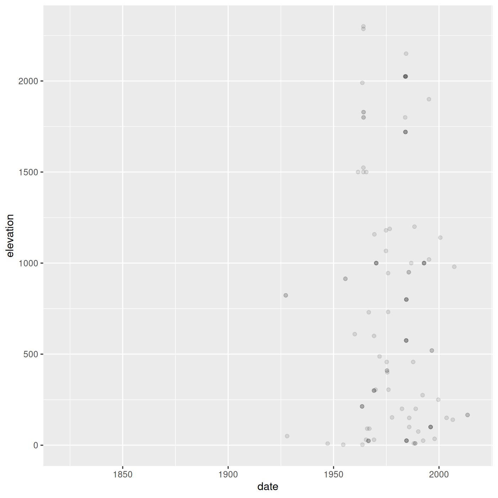

<!-- - importing complete_old CSV -->
<!--     - touch on column parsing -->
<!--     - talk about file paths and tab completion -->
<!--     - should we teach the `here()` package? -->
<!-- - base vs. tidyverse -->
<!-- - pipes -->
<!-- - select -->
<!-- - filter -->
<!--     - idea of conditional subsetting -->
<!--     - ==, >, !, |, & -->
<!--     - show %in% -->
<!-- - mutate -->
<!-- - making a date column -->
<!-- - group_by -->
<!--   - summarize -->
<!--   - mutate -->
<!--   - ungroup -->
<!-- - pivot_wider -->
<!-- - exporting data -->

<!-- Challenge ideas: -->

<!-- - plotting a time series using the date -->
<!-- - predicting # of rows before pivoting -->
<!--   - important to plan out reshaping steps in advance -->
<!-- - filter operations -->
<!--   - weight between two values -->
<!--   - maybe throw in an | example -->
<!-- - combination filter and select where doing the order wrong yields an error -->
<!--   - only has columns record_id, species_id, sex, and hindfoot_length, but weight has to be NA -->
<!-- - a couple of simple group_by operations -->
<!--   - how many combinations of plot id and genus are there -->
<!--     - could show that distinct also works here -->
<!--   - what will happen if you group by weight? -->
<!--   - an operation that requires group_by and mutate -->
<!--   - an operation that requires multiple group_by steps -->
  
:::::::::::::::::::::::::::::::::::::: questions 

- How do you manipulate tabular data in R?

::::::::::::::::::::::::::::::::::::::::::::::::

::::::::::::::::::::::::::::::::::::: objectives

- Import CSV data into R.
- Understand the difference between base R and `tidyverse` approaches.
- Subset rows and columns of data.frames.
- Use pipes to link steps together into pipelines.
- Create new data.frame columns using existing columns.
- Utilize the concept of split-apply-combine data analysis.
- Reshape data between wide and long formats.
- Export data to a CSV file.

::::::::::::::::::::::::::::::::::::::::::::::::
  


``` r
library(tidyverse)
```

## Importing data

Up until this point, we have been working with the `decaspermum` dataframe contained in the `plantdat` package. However, you typically won't access data from an R package; it is much more common to access data files stored somewhere on your computer. We are now going to start using the data in our `cleaned` directory inside the `data` directory that you downloaded at the beginning of the lesson ([instructions here](https://datacarpentry.github.io/R-ecology-lesson/introduction-r-rstudio.html#organizing-your-project-directory)). This file is called `Decaspermum_Malaysia.csv`.


#### File paths

When we reference other files from an R script, we need to give R precise instructions on where those files are. We do that using something called a **file path**. It looks something like this: `"Documents/Manuscripts/Chapter_2.txt"`. This path would tell your computer how to get from whatever folder contains the `Documents` folder all the way to the `.txt` file.

There are two kinds of paths: **absolute** and **relative**. Absolute paths are specific to a particular computer, whereas relative paths are relative to a certain folder. Because we are keeping all of our work in the `R-Ecology-Workshop` folder, all of our paths can be relative to this folder.

Now, let's read our CSV file into R and store it in an object named `surveys`. We will use the `read_csv` function from the `tidyverse`'s `readr` package, and the argument we give will be the **relative path** to the CSV file.


``` r
surveys <- read_csv("data/cleaned/Decaspermum_Malaysia.csv")
```

``` output
Rows: 964 Columns: 50
── Column specification ────────────────────────────────────────────────────────
Delimiter: ","
chr  (35): datasetKey, occurrenceID, kingdom, phylum, class, order, family, ...
dbl  (11): gbifID, individualCount, decimalLatitude, decimalLongitude, coord...
lgl   (2): depth, depthAccuracy
dttm  (2): dateIdentified, lastInterpreted

ℹ Use `spec()` to retrieve the full column specification for this data.
ℹ Specify the column types or set `show_col_types = FALSE` to quiet this message.
```

:::::::::::::::::::::::::::::::::::::::::: callout

Typing out paths can be error prone, so we can utilize a keyboard shortcut. Inside the parentheses of `read_csv()`, type out a pair of quotes and put your cursor between them. Then hit <kbd>Tab</kbd>. A small menu showing your folders and files should show up. You can use the <kbd>↑</kbd> and <kbd>↓</kbd> keys to move through the options, or start typing to narrow them down. You can hit <kbd>Enter</kbd> to select a file or folder, and hit <kbd>Tab</kbd> again to continue building the file path. This might take a bit of getting used to, but once you get the hang of it, it will speed up writing file paths and reduce the number of mistakes you make.

::::::::::::::::::::::::::::::::::::::::::

You may have noticed a bit of feedback from R when you ran the last line of code. We got some useful information about the CSV file we read in. We can see:

- the number of rows and columns
- the **delimiter** of the file, which is how values are separated, a comma `","`
- a set of columns that were **parsed** as various vector types
  - the file has numeric columns
  - we can see the names of the columns for each type
  
When working with the output of a new function, it's often a good idea to check the `class()`:


``` r
class(surveys)
```

``` output
[1] "spec_tbl_df" "tbl_df"      "tbl"         "data.frame" 
```

Whoa! What is this thing? It has multiple classes? Well, it's called a `tibble`, and it is the `tidyverse` version of a data.frame. It *is* a data.frame, but with some added perks. It prints out a little more nicely, it highlights `NA` values and negative values in red, and it will generally communicate with you more (in terms of warnings and errors, which is a good thing).

:::::::::::::::::::::::::::::::::::::::::: callout

**`tidyverse` vs. base R**

As we begin to delve more deeply into the `tidyverse`, we should briefly pause to mention some of the reasons for focusing on the `tidyverse` set of tools. In R, there are often many ways to get a job done, and there are other approaches that can accomplish tasks similar to the `tidyverse`.

The phrase **base R** is used to refer to approaches that utilize functions contained in R's default packages. We have already used some base R functions, such as `str()`, `head()`, and `mean()`, and we will be using more scattered throughout this lesson. However, there are some key base R approaches we will not be teaching. These include square bracket subsetting and base plotting. You may come across code written by other people that looks like `surveys[1:10, 2]` or `plot(surveys$weight, surveys$hindfoot_length)`, which are base R commands. If you're interested in learning more about these approaches, you can check out other Carpentries lessons like the [Software Carpentry Programming with R](https://swcarpentry.github.io/r-novice-inflammation/) lesson.

We choose to teach the `tidyverse` set of packages because they share a similar syntax and philosophy, making them consistent and producing highly readable code. They are also very flexible and powerful, with a growing number of packages designed according to similar principles and to work well with the rest of the packages. The `tidyverse` packages tend to have very clear documentation and wide array of learning materials that tend to be written with novice users in mind. Finally, the `tidyverse` has only continued to grow, and has strong support from RStudio, which implies that these approaches will be relevant into the future.

::::::::::::::::::::::::::::::::::::::::::

## Manipulating data

One of the most important skills for working with data in R is the ability to manipulate, modify, and reshape data. The `dplyr` and `tidyr` packages in the `tidyverse` provide a series of powerful functions for many common data manipulation tasks.

We'll start off with two of the most commonly used `dplyr` functions: `select()`, which selects certain columns of a data.frame, and `filter()`, which filters out rows according to certain criteria.

:::::::::::::::::::::::::::::::::::::::::: callout

Between `select()` and `filter()`, it can be hard to remember which operates on columns and which operates on rows. `sele`**`c`**`t()` has a **c** for **c**olumns and `filte`**`r`**`()` has an **r** for **r**ows.

::::::::::::::::::::::::::::::::::::::::::

#### `select()`

To use the `select()` function, the first argument is the name of the data.frame, and the rest of the arguments are *unquoted* names of the columns you want:


``` r
select(surveys, genus, species, year, elevation)
```

``` output
# A tibble: 964 × 4
   genus       species                  year elevation
   <chr>       <chr>                   <dbl>     <dbl>
 1 Decaspermum Decaspermum fruticosum   1990       75 
 2 Decaspermum Decaspermum fruticosum   1984       25 
 3 Decaspermum Decaspermum fruticosum   1976       NA 
 4 Decaspermum Decaspermum fruticosum   1984      575 
 5 Decaspermum Decaspermum vitis-idaea  1983     2025 
 6 Decaspermum Decaspermum montanum     1975      945.
 7 Decaspermum Decaspermum fruticosum   1974     1180 
 8 Decaspermum Decaspermum fruticosum   1975      732.
 9 Decaspermum Decaspermum fruticosum   1975      410 
10 Decaspermum Decaspermum fruticosum   1975      400 
# ℹ 954 more rows
```

The columns are arranged in the order we specified inside `select()`.

To select all columns except specific columns, put a `-` in front of the column you want to exclude:


``` r
select(surveys, -elevation, -year)
```

``` output
# A tibble: 964 × 48
       gbifID datasetKey    occurrenceID kingdom phylum class order family genus
        <dbl> <chr>         <chr>        <chr>   <chr>  <chr> <chr> <chr>  <chr>
 1 6561832516 7bd65a7a-f76… urn:catalog… Plantae Trach… Magn… Myrt… Myrta… Deca…
 2 6561807785 7bd65a7a-f76… urn:catalog… Plantae Trach… Magn… Myrt… Myrta… Deca…
 3 6561784372 7bd65a7a-f76… urn:catalog… Plantae Trach… Magn… Myrt… Myrta… Deca…
 4 6561766817 7bd65a7a-f76… urn:catalog… Plantae Trach… Magn… Myrt… Myrta… Deca…
 5 6561753311 7bd65a7a-f76… urn:catalog… Plantae Trach… Magn… Myrt… Myrta… Deca…
 6 6561730396 7bd65a7a-f76… urn:catalog… Plantae Trach… Magn… Myrt… Myrta… Deca…
 7 6561650622 7bd65a7a-f76… urn:catalog… Plantae Trach… Magn… Myrt… Myrta… Deca…
 8 6561612723 7bd65a7a-f76… urn:catalog… Plantae Trach… Magn… Myrt… Myrta… Deca…
 9 6561592184 7bd65a7a-f76… urn:catalog… Plantae Trach… Magn… Myrt… Myrta… Deca…
10 6561592042 7bd65a7a-f76… urn:catalog… Plantae Trach… Magn… Myrt… Myrta… Deca…
# ℹ 954 more rows
# ℹ 39 more variables: species <chr>, infraspecificEpithet <chr>,
#   taxonRank <chr>, scientificName <chr>, verbatimScientificName <chr>,
#   verbatimScientificNameAuthorship <chr>, countryCode <chr>, locality <chr>,
#   stateProvince <chr>, occurrenceStatus <chr>, individualCount <dbl>,
#   publishingOrgKey <chr>, decimalLatitude <dbl>, decimalLongitude <dbl>,
#   coordinateUncertaintyInMeters <dbl>, coordinatePrecision <dbl>, …
```

`select()` also works with numeric vectors for the order of the columns. To select the 3rd, 4th, 5th, and 10th columns, we could run the following code:


``` r
select(surveys, c(3:5, 10))
```

``` output
# A tibble: 964 × 4
   occurrenceID                      kingdom phylum       species               
   <chr>                             <chr>   <chr>        <chr>                 
 1 urn:catalog:MO:Tropicos:105482819 Plantae Tracheophyta Decaspermum fruticosum
 2 urn:catalog:MO:Tropicos:105427229 Plantae Tracheophyta Decaspermum fruticosum
 3 urn:catalog:MO:Tropicos:105414318 Plantae Tracheophyta Decaspermum fruticosum
 4 urn:catalog:MO:Tropicos:105642053 Plantae Tracheophyta Decaspermum fruticosum
 5 urn:catalog:MO:Tropicos:105301980 Plantae Tracheophyta Decaspermum vitis-ida…
 6 urn:catalog:MO:Tropicos:105550279 Plantae Tracheophyta Decaspermum montanum  
 7 urn:catalog:MO:Tropicos:105457468 Plantae Tracheophyta Decaspermum fruticosum
 8 urn:catalog:MO:Tropicos:105516019 Plantae Tracheophyta Decaspermum fruticosum
 9 urn:catalog:MO:Tropicos:105412914 Plantae Tracheophyta Decaspermum fruticosum
10 urn:catalog:MO:Tropicos:105419266 Plantae Tracheophyta Decaspermum fruticosum
# ℹ 954 more rows
```

You should be careful when using this method, since you are being less explicit about which columns you want. However, it can be useful if you have a data.frame with many columns and you don't want to type out too many names.

Finally, you can select columns based on whether they match a certain criteria by using the `where()` function. If we want all numeric columns, we can ask to `select` all the columns `where` the class `is numeric`:


``` r
select(surveys, where(is.numeric))
```

``` output
# A tibble: 964 × 11
       gbifID individualCount decimalLatitude decimalLongitude
        <dbl>           <dbl>           <dbl>            <dbl>
 1 6561832516              NA            6                101.
 2 6561807785              NA            5.97             116.
 3 6561784372              NA           NA                 NA 
 4 6561766817              NA            4.97             118.
 5 6561753311              NA            6.05             117.
 6 6561730396              NA           NA                 NA 
 7 6561650622              NA           NA                 NA 
 8 6561612723              NA           NA                 NA 
 9 6561592184              NA           NA                 NA 
10 6561592042              NA           NA                 NA 
# ℹ 954 more rows
# ℹ 7 more variables: coordinateUncertaintyInMeters <dbl>,
#   coordinatePrecision <dbl>, elevation <dbl>, elevationAccuracy <dbl>,
#   day <dbl>, month <dbl>, year <dbl>
```

Instead of giving names or positions of columns, we instead pass the `where()` function with the name of another function inside it, in this case `is.numeric()`, and we get all the columns for which that function returns `TRUE`.

We can use this to select any columns that have any `NA` values in them:


``` r
select(surveys, where(anyNA))
```

``` output
# A tibble: 964 × 31
   species    infraspecificEpithet verbatimScientificNa…¹ locality stateProvince
   <chr>      <chr>                <chr>                  <chr>    <chr>        
 1 Decasperm… <NA>                 J.R. Forst. & G. Fors… Malay P… Kelantan     
 2 Decasperm… <NA>                 J.R. Forst. & G. Fors… Borneo;… Sabah        
 3 Decasperm… <NA>                 J.R. Forst. & G. Fors… Taiton … <NA>         
 4 Decasperm… <NA>                 J.R. Forst. & G. Fors… Borneo;… Sabah        
 5 Decasperm… <NA>                 Stapf                  Borneo;… Sabah        
 6 Decasperm… <NA>                 Ridl.                  Gunong … Kedah        
 7 Decasperm… <NA>                 J.R. Forst. & G. Fors… Arul Li… <NA>         
 8 Decasperm… <NA>                 J.R. Forst. & G. Fors… Penang … Penang       
 9 Decasperm… <NA>                 J.R. Forst. & G. Fors… Bkt. Br… <NA>         
10 Decasperm… <NA>                 J.R. Forst. & G. Fors… Bukit T… Selangor     
# ℹ 954 more rows
# ℹ abbreviated name: ¹​verbatimScientificNameAuthorship
# ℹ 26 more variables: individualCount <dbl>, decimalLatitude <dbl>,
#   decimalLongitude <dbl>, coordinateUncertaintyInMeters <dbl>,
#   coordinatePrecision <dbl>, elevation <dbl>, elevationAccuracy <dbl>,
#   depth <lgl>, depthAccuracy <lgl>, eventDate <chr>, day <dbl>, month <dbl>,
#   year <dbl>, speciesKey <chr>, institutionCode <chr>, …
```

#### `filter()`

The `filter()` function is used to select rows that meet certain criteria. To get all the rows where the value of `year` is equal to 1985, we would run the following:


``` r
filter(surveys, year == 1985)
```

``` output
# A tibble: 19 × 50
       gbifID datasetKey    occurrenceID kingdom phylum class order family genus
        <dbl> <chr>         <chr>        <chr>   <chr>  <chr> <chr> <chr>  <chr>
 1 6561429663 7bd65a7a-f76… urn:catalog… Plantae Trach… Magn… Myrt… Myrta… Deca…
 2 4977561075 cd6e21c8-9e8… http://spec… Plantae Trach… Magn… Myrt… Myrta… Deca…
 3 4858989387 cd6e21c8-9e8… http://spec… Plantae Trach… Magn… Myrt… Myrta… Deca…
 4 4858973318 cd6e21c8-9e8… http://spec… Plantae Trach… Magn… Myrt… Myrta… Deca…
 5 4858973304 cd6e21c8-9e8… http://spec… Plantae Trach… Magn… Myrt… Myrta… Deca…
 6 4858968916 cd6e21c8-9e8… http://spec… Plantae Trach… Magn… Myrt… Myrta… Deca…
 7 4850462398 cd6e21c8-9e8… http://spec… Plantae Trach… Magn… Myrt… Myrta… Deca…
 8 4850461090 cd6e21c8-9e8… http://spec… Plantae Trach… Magn… Myrt… Myrta… Deca…
 9 4401127340 861e6afe-f76… 6ad33d6c-36… Plantae Trach… Magn… Myrt… Myrta… Deca…
10 4401121355 861e6afe-f76… 76a26cc9-c4… Plantae Trach… Magn… Myrt… Myrta… Deca…
11 2516699077 15f819bd-661… https://dat… Plantae Trach… Magn… Myrt… Myrta… Deca…
12 2516291363 15f819bd-661… https://dat… Plantae Trach… Magn… Myrt… Myrta… Deca…
13 2516291190 15f819bd-661… https://dat… Plantae Trach… Magn… Myrt… Myrta… Deca…
14 2516276207 15f819bd-661… https://dat… Plantae Trach… Magn… Myrt… Myrta… Deca…
15 2516213427 15f819bd-661… https://dat… Plantae Trach… Magn… Myrt… Myrta… Deca…
16 2515066186 15f819bd-661… https://dat… Plantae Trach… Magn… Myrt… Myrta… Deca…
17 2514464455 15f819bd-661… https://dat… Plantae Trach… Magn… Myrt… Myrta… Deca…
18 2514427660 15f819bd-661… https://dat… Plantae Trach… Magn… Myrt… Myrta… Deca…
19 2514412446 15f819bd-661… https://dat… Plantae Trach… Magn… Myrt… Myrta… Deca…
# ℹ 41 more variables: species <chr>, infraspecificEpithet <chr>,
#   taxonRank <chr>, scientificName <chr>, verbatimScientificName <chr>,
#   verbatimScientificNameAuthorship <chr>, countryCode <chr>, locality <chr>,
#   stateProvince <chr>, occurrenceStatus <chr>, individualCount <dbl>,
#   publishingOrgKey <chr>, decimalLatitude <dbl>, decimalLongitude <dbl>,
#   coordinateUncertaintyInMeters <dbl>, coordinatePrecision <dbl>,
#   elevation <dbl>, elevationAccuracy <dbl>, depth <lgl>, …
```

The `==` sign means "is equal to". There are several other operators we can use: >, >=, <, <=, and != (not equal to). Another useful operator is `%in%`, which asks if the value on the lefthand side is found anywhere in the vector on the righthand side. For example, to get rows with specific `species_id` values, we could run:


``` r
filter(surveys, stateProvince %in% c("Borneo", "Sarawak"))
```

``` output
# A tibble: 193 × 50
       gbifID datasetKey    occurrenceID kingdom phylum class order family genus
        <dbl> <chr>         <chr>        <chr>   <chr>  <chr> <chr> <chr>  <chr>
 1 6561379339 7bd65a7a-f76… urn:catalog… Plantae Trach… Magn… Myrt… Myrta… Deca…
 2 5956592965 cfb43618-142… 657150       Plantae Trach… Magn… Myrt… Myrta… Deca…
 3 5956549004 cfb43618-142… 164551       Plantae Trach… Magn… Myrt… Myrta… Deca…
 4 4906914238 15f819bd-661… https://dat… Plantae Trach… Magn… Myrt… Myrta… Deca…
 5 4404057434 861e6afe-f76… 57c51ab5-94… Plantae Trach… Magn… Myrt… Myrta… Deca…
 6 4404051550 861e6afe-f76… b4550d67-e7… Plantae Trach… Magn… Myrt… Myrta… Deca…
 7 4404050440 861e6afe-f76… 6bcd9d6a-9f… Plantae Trach… Magn… Myrt… Myrta… Deca…
 8 4401132420 861e6afe-f76… fe06a857-0a… Plantae Trach… Magn… Myrt… Myrta… Deca…
 9 4401132331 861e6afe-f76… 4ef97ebf-55… Plantae Trach… Magn… Myrt… Myrta… Deca…
10 4401132320 861e6afe-f76… 353fa595-96… Plantae Trach… Magn… Myrt… Myrta… Deca…
# ℹ 183 more rows
# ℹ 41 more variables: species <chr>, infraspecificEpithet <chr>,
#   taxonRank <chr>, scientificName <chr>, verbatimScientificName <chr>,
#   verbatimScientificNameAuthorship <chr>, countryCode <chr>, locality <chr>,
#   stateProvince <chr>, occurrenceStatus <chr>, individualCount <dbl>,
#   publishingOrgKey <chr>, decimalLatitude <dbl>, decimalLongitude <dbl>,
#   coordinateUncertaintyInMeters <dbl>, coordinatePrecision <dbl>, …
```

We can also use multiple conditions in one `filter()` statement. Here we will get rows with a year less than or equal to 1988 and whose hindfoot length values are not `NA`. The `!` before the `is.na()` function means "not".


``` r
filter(surveys, year <= 1988 & !is.na(elevation))
```

``` output
# A tibble: 94 × 50
       gbifID datasetKey    occurrenceID kingdom phylum class order family genus
        <dbl> <chr>         <chr>        <chr>   <chr>  <chr> <chr> <chr>  <chr>
 1 6561807785 7bd65a7a-f76… urn:catalog… Plantae Trach… Magn… Myrt… Myrta… Deca…
 2 6561766817 7bd65a7a-f76… urn:catalog… Plantae Trach… Magn… Myrt… Myrta… Deca…
 3 6561753311 7bd65a7a-f76… urn:catalog… Plantae Trach… Magn… Myrt… Myrta… Deca…
 4 6561730396 7bd65a7a-f76… urn:catalog… Plantae Trach… Magn… Myrt… Myrta… Deca…
 5 6561650622 7bd65a7a-f76… urn:catalog… Plantae Trach… Magn… Myrt… Myrta… Deca…
 6 6561612723 7bd65a7a-f76… urn:catalog… Plantae Trach… Magn… Myrt… Myrta… Deca…
 7 6561592184 7bd65a7a-f76… urn:catalog… Plantae Trach… Magn… Myrt… Myrta… Deca…
 8 6561592042 7bd65a7a-f76… urn:catalog… Plantae Trach… Magn… Myrt… Myrta… Deca…
 9 6561582852 7bd65a7a-f76… urn:catalog… Plantae Trach… Magn… Myrt… Myrta… Deca…
10 6561508200 7bd65a7a-f76… urn:catalog… Plantae Trach… Magn… Myrt… Myrta… Deca…
# ℹ 84 more rows
# ℹ 41 more variables: species <chr>, infraspecificEpithet <chr>,
#   taxonRank <chr>, scientificName <chr>, verbatimScientificName <chr>,
#   verbatimScientificNameAuthorship <chr>, countryCode <chr>, locality <chr>,
#   stateProvince <chr>, occurrenceStatus <chr>, individualCount <dbl>,
#   publishingOrgKey <chr>, decimalLatitude <dbl>, decimalLongitude <dbl>,
#   coordinateUncertaintyInMeters <dbl>, coordinatePrecision <dbl>, …
```


::::::::::::::::::::::::::::::::::::: challenge

## Challenge 1: Filtering and selecting

1. Use the surveys data to make a data.frame that has only data with years from 1980 to 1985.

:::::::::::::::::::::::: solution


``` r
surveys_filtered <- filter(surveys, year >= 1980 & year <= 1985)
```

::::::::::::::::::::::::

2. Use the surveys data to make a data.frame that has only the following columns, in order: `year`, `month`, `speciesKey`, `coordinateUncertaintyInMeters`.

:::::::::::::::::::::::: solution


``` r
surveys_selected <- select(surveys, year, month, speciesKey, coordinateUncertaintyInMeters)
```

::::::::::::::::::::::::

::::::::::::::::::::::::::::::::::::::::::::::::

## The pipe: `%>%`

What happens if we want to both `select()` and `filter()` our data? We have a couple options. First, we could use **nested** functions:


``` r
filter(select(surveys, -day), month >= 7)
```

``` output
# A tibble: 371 × 49
       gbifID datasetKey    occurrenceID kingdom phylum class order family genus
        <dbl> <chr>         <chr>        <chr>   <chr>  <chr> <chr> <chr>  <chr>
 1 6561807785 7bd65a7a-f76… urn:catalog… Plantae Trach… Magn… Myrt… Myrta… Deca…
 2 6561753311 7bd65a7a-f76… urn:catalog… Plantae Trach… Magn… Myrt… Myrta… Deca…
 3 6561730396 7bd65a7a-f76… urn:catalog… Plantae Trach… Magn… Myrt… Myrta… Deca…
 4 6561650622 7bd65a7a-f76… urn:catalog… Plantae Trach… Magn… Myrt… Myrta… Deca…
 5 6561612723 7bd65a7a-f76… urn:catalog… Plantae Trach… Magn… Myrt… Myrta… Deca…
 6 6561582852 7bd65a7a-f76… urn:catalog… Plantae Trach… Magn… Myrt… Myrta… Deca…
 7 6561491291 7bd65a7a-f76… urn:catalog… Plantae Trach… Magn… Myrt… Myrta… Deca…
 8 6561429663 7bd65a7a-f76… urn:catalog… Plantae Trach… Magn… Myrt… Myrta… Deca…
 9 6561426864 7bd65a7a-f76… urn:catalog… Plantae Trach… Magn… Myrt… Myrta… Deca…
10 6561393056 7bd65a7a-f76… urn:catalog… Plantae Trach… Magn… Myrt… Myrta… Deca…
# ℹ 361 more rows
# ℹ 40 more variables: species <chr>, infraspecificEpithet <chr>,
#   taxonRank <chr>, scientificName <chr>, verbatimScientificName <chr>,
#   verbatimScientificNameAuthorship <chr>, countryCode <chr>, locality <chr>,
#   stateProvince <chr>, occurrenceStatus <chr>, individualCount <dbl>,
#   publishingOrgKey <chr>, decimalLatitude <dbl>, decimalLongitude <dbl>,
#   coordinateUncertaintyInMeters <dbl>, coordinatePrecision <dbl>, …
```

R will evaluate statements from the inside out. First, `select()` will operate on the `surveys` data.frame, removing the column `day`. The resulting data.frame is then used as the first argument for `filter()`, which selects rows with a month greater than or equal to 7.

Nested functions can be very difficult to read with only a few functions, and nearly impossible when many functions are done at once. An alternative approach is to create **intermediate** objects:


``` r
surveys_noday <- select(surveys, -day)
filter(surveys_noday, month >= 7)
```

``` output
# A tibble: 371 × 49
       gbifID datasetKey    occurrenceID kingdom phylum class order family genus
        <dbl> <chr>         <chr>        <chr>   <chr>  <chr> <chr> <chr>  <chr>
 1 6561807785 7bd65a7a-f76… urn:catalog… Plantae Trach… Magn… Myrt… Myrta… Deca…
 2 6561753311 7bd65a7a-f76… urn:catalog… Plantae Trach… Magn… Myrt… Myrta… Deca…
 3 6561730396 7bd65a7a-f76… urn:catalog… Plantae Trach… Magn… Myrt… Myrta… Deca…
 4 6561650622 7bd65a7a-f76… urn:catalog… Plantae Trach… Magn… Myrt… Myrta… Deca…
 5 6561612723 7bd65a7a-f76… urn:catalog… Plantae Trach… Magn… Myrt… Myrta… Deca…
 6 6561582852 7bd65a7a-f76… urn:catalog… Plantae Trach… Magn… Myrt… Myrta… Deca…
 7 6561491291 7bd65a7a-f76… urn:catalog… Plantae Trach… Magn… Myrt… Myrta… Deca…
 8 6561429663 7bd65a7a-f76… urn:catalog… Plantae Trach… Magn… Myrt… Myrta… Deca…
 9 6561426864 7bd65a7a-f76… urn:catalog… Plantae Trach… Magn… Myrt… Myrta… Deca…
10 6561393056 7bd65a7a-f76… urn:catalog… Plantae Trach… Magn… Myrt… Myrta… Deca…
# ℹ 361 more rows
# ℹ 40 more variables: species <chr>, infraspecificEpithet <chr>,
#   taxonRank <chr>, scientificName <chr>, verbatimScientificName <chr>,
#   verbatimScientificNameAuthorship <chr>, countryCode <chr>, locality <chr>,
#   stateProvince <chr>, occurrenceStatus <chr>, individualCount <dbl>,
#   publishingOrgKey <chr>, decimalLatitude <dbl>, decimalLongitude <dbl>,
#   coordinateUncertaintyInMeters <dbl>, coordinatePrecision <dbl>, …
```

This approach is easier to read, since we can see the steps in order, but after enough steps, we are left with a cluttered mess of intermediate objects, often with confusing names.

An elegant solution to this problem is an operator called the **pipe**, which looks like `%>%`. You can insert it by using the keyboard shortcut <kbd>Shift+Cmd+M</kbd> (Mac) or <kbd>Shift+Ctrl+M</kbd> (Windows). Here's how you could use a pipe to select and filter in one step:


``` r
surveys %>% 
  select(-day) %>% 
  filter(month >= 7)
```

``` output
# A tibble: 371 × 49
       gbifID datasetKey    occurrenceID kingdom phylum class order family genus
        <dbl> <chr>         <chr>        <chr>   <chr>  <chr> <chr> <chr>  <chr>
 1 6561807785 7bd65a7a-f76… urn:catalog… Plantae Trach… Magn… Myrt… Myrta… Deca…
 2 6561753311 7bd65a7a-f76… urn:catalog… Plantae Trach… Magn… Myrt… Myrta… Deca…
 3 6561730396 7bd65a7a-f76… urn:catalog… Plantae Trach… Magn… Myrt… Myrta… Deca…
 4 6561650622 7bd65a7a-f76… urn:catalog… Plantae Trach… Magn… Myrt… Myrta… Deca…
 5 6561612723 7bd65a7a-f76… urn:catalog… Plantae Trach… Magn… Myrt… Myrta… Deca…
 6 6561582852 7bd65a7a-f76… urn:catalog… Plantae Trach… Magn… Myrt… Myrta… Deca…
 7 6561491291 7bd65a7a-f76… urn:catalog… Plantae Trach… Magn… Myrt… Myrta… Deca…
 8 6561429663 7bd65a7a-f76… urn:catalog… Plantae Trach… Magn… Myrt… Myrta… Deca…
 9 6561426864 7bd65a7a-f76… urn:catalog… Plantae Trach… Magn… Myrt… Myrta… Deca…
10 6561393056 7bd65a7a-f76… urn:catalog… Plantae Trach… Magn… Myrt… Myrta… Deca…
# ℹ 361 more rows
# ℹ 40 more variables: species <chr>, infraspecificEpithet <chr>,
#   taxonRank <chr>, scientificName <chr>, verbatimScientificName <chr>,
#   verbatimScientificNameAuthorship <chr>, countryCode <chr>, locality <chr>,
#   stateProvince <chr>, occurrenceStatus <chr>, individualCount <dbl>,
#   publishingOrgKey <chr>, decimalLatitude <dbl>, decimalLongitude <dbl>,
#   coordinateUncertaintyInMeters <dbl>, coordinatePrecision <dbl>, …
```

What it does is take the thing on the lefthand side and insert it as the first argument of the function on the righthand side. By putting each of our functions onto a new line, we can build a nice, readable **pipeline**. It can be useful to think of this as a little assembly line for our data. It starts at the top and gets piped into a `select()` function, and it comes out modified somewhat. It then gets sent into the `filter()` function, where it is further modified, and then the final product gets printed out to our console. It can also be helpful to think of `%>%` as meaning "and then". Since many `tidyverse` functions have verbs for names, a pipeline can be read like a sentence.


:::::::::::::::::::::::::::::::::::::::::::: instructor
It's worth showing the learners that you can run a **pipeline** without highlighting the whole thing. If your cursor is on any line of a pipeline, running that line will run the whole thing.

You can also show that by highlighting a section of a pipeline, you can run only the first X steps of it.
::::::::::::::::::::::::::::::::::::::::::::

If we want to store this final product as an object, we use an assignment arrow at the start:


``` r
surveys_sub <- surveys %>% 
  select(-day) %>% 
  filter(month >= 7)
```

A good approach is to build a pipeline step by step prior to assignment. You add functions to the pipeline as you go, with the results printing in the console for you to view. Once you're satisfied with your final result, go back and add the assignment arrow statement at the start. This approach is very interactive, allowing you to see the results of each step as you build the pipeline, and produces nicely readable code.

::::::::::::::::::::::::::::::::::::: challenge

## Challenge 2: Using pipes

Use the surveys data to make a data.frame that has the columns `speciesKey`, `month`, and `coordinateUncertaintyInMeters`, with data from the year 1988. Use a pipe between the function calls.

:::::::::::::::::::::::: solution


``` r
surveys_1988 <- surveys %>%
  filter(year == 1988) %>%
  select(speciesKey, month, coordinateUncertaintyInMeters)
```

Make sure to `filter()` before you `select()`. You need to use the `year` column for filtering rows, but it is discarded in the `select()` step. You also need to make sure to use `==` instead of `=` when you are filtering rows where `year` is equal to 1988.

::::::::::::::::::::::::
::::::::::::::::::::::::::::::::::::::::::::::::


## Making new columns with `mutate()`

Another common task is creating a new column based on values in existing columns. For example, we could add a new column that has the weight in kilograms instead of grams:


``` r
surveys %>% 
  mutate(uncertainty_km = coordinateUncertaintyInMeters / 1000) %>%
  select(uncertainty_km) %>%
 arrange(desc(uncertainty_km))
```

``` output
# A tibble: 964 × 1
   uncertainty_km
            <dbl>
 1            100
 2             50
 3             25
 4             25
 5             25
 6             25
 7             10
 8             10
 9             10
10              2
# ℹ 954 more rows
```

You can create multiple columns in one `mutate()` call, and they will get created in the order you write them. You can use `arrange` and `desc` to sort them as well.


<!-- This next part could definitely be moved to the next lesson if need be -->

We can also use multiple columns to create a single column. For example, it's often good practice to keep the components of a date in separate columns until necessary, as we've done here. This is because programs like Excel can do automatic things with dates in a way that is not reproducible and sometimes hard to notice. However, now that we are working in R, we can safely put together a date column.

To put together the columns into something that looks like a date, we can use the `paste()` function, which takes arguments of the items to paste together, as well as the argument `sep`, which is the character used to separate the items.


``` r
surveys %>% 
  mutate(date = paste(year, month, day, sep = "-"))
```

``` output
# A tibble: 964 × 51
       gbifID datasetKey    occurrenceID kingdom phylum class order family genus
        <dbl> <chr>         <chr>        <chr>   <chr>  <chr> <chr> <chr>  <chr>
 1 6561832516 7bd65a7a-f76… urn:catalog… Plantae Trach… Magn… Myrt… Myrta… Deca…
 2 6561807785 7bd65a7a-f76… urn:catalog… Plantae Trach… Magn… Myrt… Myrta… Deca…
 3 6561784372 7bd65a7a-f76… urn:catalog… Plantae Trach… Magn… Myrt… Myrta… Deca…
 4 6561766817 7bd65a7a-f76… urn:catalog… Plantae Trach… Magn… Myrt… Myrta… Deca…
 5 6561753311 7bd65a7a-f76… urn:catalog… Plantae Trach… Magn… Myrt… Myrta… Deca…
 6 6561730396 7bd65a7a-f76… urn:catalog… Plantae Trach… Magn… Myrt… Myrta… Deca…
 7 6561650622 7bd65a7a-f76… urn:catalog… Plantae Trach… Magn… Myrt… Myrta… Deca…
 8 6561612723 7bd65a7a-f76… urn:catalog… Plantae Trach… Magn… Myrt… Myrta… Deca…
 9 6561592184 7bd65a7a-f76… urn:catalog… Plantae Trach… Magn… Myrt… Myrta… Deca…
10 6561592042 7bd65a7a-f76… urn:catalog… Plantae Trach… Magn… Myrt… Myrta… Deca…
# ℹ 954 more rows
# ℹ 42 more variables: species <chr>, infraspecificEpithet <chr>,
#   taxonRank <chr>, scientificName <chr>, verbatimScientificName <chr>,
#   verbatimScientificNameAuthorship <chr>, countryCode <chr>, locality <chr>,
#   stateProvince <chr>, occurrenceStatus <chr>, individualCount <dbl>,
#   publishingOrgKey <chr>, decimalLatitude <dbl>, decimalLongitude <dbl>,
#   coordinateUncertaintyInMeters <dbl>, coordinatePrecision <dbl>, …
```

Since our new column gets moved all the way to the end, it doesn't end up printing out. We can use the `relocate()` function to put it after our `year` column:


``` r
surveys %>% 
  mutate(date = paste(year, month, day, sep = "-")) %>% 
  relocate(date, .after = year)
```

``` output
# A tibble: 964 × 51
       gbifID datasetKey    occurrenceID kingdom phylum class order family genus
        <dbl> <chr>         <chr>        <chr>   <chr>  <chr> <chr> <chr>  <chr>
 1 6561832516 7bd65a7a-f76… urn:catalog… Plantae Trach… Magn… Myrt… Myrta… Deca…
 2 6561807785 7bd65a7a-f76… urn:catalog… Plantae Trach… Magn… Myrt… Myrta… Deca…
 3 6561784372 7bd65a7a-f76… urn:catalog… Plantae Trach… Magn… Myrt… Myrta… Deca…
 4 6561766817 7bd65a7a-f76… urn:catalog… Plantae Trach… Magn… Myrt… Myrta… Deca…
 5 6561753311 7bd65a7a-f76… urn:catalog… Plantae Trach… Magn… Myrt… Myrta… Deca…
 6 6561730396 7bd65a7a-f76… urn:catalog… Plantae Trach… Magn… Myrt… Myrta… Deca…
 7 6561650622 7bd65a7a-f76… urn:catalog… Plantae Trach… Magn… Myrt… Myrta… Deca…
 8 6561612723 7bd65a7a-f76… urn:catalog… Plantae Trach… Magn… Myrt… Myrta… Deca…
 9 6561592184 7bd65a7a-f76… urn:catalog… Plantae Trach… Magn… Myrt… Myrta… Deca…
10 6561592042 7bd65a7a-f76… urn:catalog… Plantae Trach… Magn… Myrt… Myrta… Deca…
# ℹ 954 more rows
# ℹ 42 more variables: species <chr>, infraspecificEpithet <chr>,
#   taxonRank <chr>, scientificName <chr>, verbatimScientificName <chr>,
#   verbatimScientificNameAuthorship <chr>, countryCode <chr>, locality <chr>,
#   stateProvince <chr>, occurrenceStatus <chr>, individualCount <dbl>,
#   publishingOrgKey <chr>, decimalLatitude <dbl>, decimalLongitude <dbl>,
#   coordinateUncertaintyInMeters <dbl>, coordinatePrecision <dbl>, …
```

Now we can see that we have a character column that contains our date string. However, it's not truly a date column. Dates are a type of numeric variable with a defined, ordered scale. To turn this column into a proper date, we will use a function from the `tidyverse`'s `lubridate` package, which has lots of useful functions for working with dates. The function `ymd()` will parse a date string that has the order year-month-day. Let's load the package and use `ymd()`.


``` r
library(lubridate)

surveys %>% 
  mutate(date = paste(year, month, day, sep = "-"),
         date = ymd(date)) %>% 
  relocate(date, .after = year)
```

``` warning
Warning: There was 1 warning in `mutate()`.
ℹ In argument: `date = ymd(date)`.
Caused by warning:
!  225 failed to parse.
```

``` output
# A tibble: 964 × 51
       gbifID datasetKey    occurrenceID kingdom phylum class order family genus
        <dbl> <chr>         <chr>        <chr>   <chr>  <chr> <chr> <chr>  <chr>
 1 6561832516 7bd65a7a-f76… urn:catalog… Plantae Trach… Magn… Myrt… Myrta… Deca…
 2 6561807785 7bd65a7a-f76… urn:catalog… Plantae Trach… Magn… Myrt… Myrta… Deca…
 3 6561784372 7bd65a7a-f76… urn:catalog… Plantae Trach… Magn… Myrt… Myrta… Deca…
 4 6561766817 7bd65a7a-f76… urn:catalog… Plantae Trach… Magn… Myrt… Myrta… Deca…
 5 6561753311 7bd65a7a-f76… urn:catalog… Plantae Trach… Magn… Myrt… Myrta… Deca…
 6 6561730396 7bd65a7a-f76… urn:catalog… Plantae Trach… Magn… Myrt… Myrta… Deca…
 7 6561650622 7bd65a7a-f76… urn:catalog… Plantae Trach… Magn… Myrt… Myrta… Deca…
 8 6561612723 7bd65a7a-f76… urn:catalog… Plantae Trach… Magn… Myrt… Myrta… Deca…
 9 6561592184 7bd65a7a-f76… urn:catalog… Plantae Trach… Magn… Myrt… Myrta… Deca…
10 6561592042 7bd65a7a-f76… urn:catalog… Plantae Trach… Magn… Myrt… Myrta… Deca…
# ℹ 954 more rows
# ℹ 42 more variables: species <chr>, infraspecificEpithet <chr>,
#   taxonRank <chr>, scientificName <chr>, verbatimScientificName <chr>,
#   verbatimScientificNameAuthorship <chr>, countryCode <chr>, locality <chr>,
#   stateProvince <chr>, occurrenceStatus <chr>, individualCount <dbl>,
#   publishingOrgKey <chr>, decimalLatitude <dbl>, decimalLongitude <dbl>,
#   coordinateUncertaintyInMeters <dbl>, coordinatePrecision <dbl>, …
```

``` r
surveys %>% 
  mutate(date = paste(year, month, day, sep = "-"),
         date = as.Date(date)) %>% 
  relocate(date, .after = year)
```

``` output
# A tibble: 964 × 51
       gbifID datasetKey    occurrenceID kingdom phylum class order family genus
        <dbl> <chr>         <chr>        <chr>   <chr>  <chr> <chr> <chr>  <chr>
 1 6561832516 7bd65a7a-f76… urn:catalog… Plantae Trach… Magn… Myrt… Myrta… Deca…
 2 6561807785 7bd65a7a-f76… urn:catalog… Plantae Trach… Magn… Myrt… Myrta… Deca…
 3 6561784372 7bd65a7a-f76… urn:catalog… Plantae Trach… Magn… Myrt… Myrta… Deca…
 4 6561766817 7bd65a7a-f76… urn:catalog… Plantae Trach… Magn… Myrt… Myrta… Deca…
 5 6561753311 7bd65a7a-f76… urn:catalog… Plantae Trach… Magn… Myrt… Myrta… Deca…
 6 6561730396 7bd65a7a-f76… urn:catalog… Plantae Trach… Magn… Myrt… Myrta… Deca…
 7 6561650622 7bd65a7a-f76… urn:catalog… Plantae Trach… Magn… Myrt… Myrta… Deca…
 8 6561612723 7bd65a7a-f76… urn:catalog… Plantae Trach… Magn… Myrt… Myrta… Deca…
 9 6561592184 7bd65a7a-f76… urn:catalog… Plantae Trach… Magn… Myrt… Myrta… Deca…
10 6561592042 7bd65a7a-f76… urn:catalog… Plantae Trach… Magn… Myrt… Myrta… Deca…
# ℹ 954 more rows
# ℹ 42 more variables: species <chr>, infraspecificEpithet <chr>,
#   taxonRank <chr>, scientificName <chr>, verbatimScientificName <chr>,
#   verbatimScientificNameAuthorship <chr>, countryCode <chr>, locality <chr>,
#   stateProvince <chr>, occurrenceStatus <chr>, individualCount <dbl>,
#   publishingOrgKey <chr>, decimalLatitude <dbl>, decimalLongitude <dbl>,
#   coordinateUncertaintyInMeters <dbl>, coordinatePrecision <dbl>, …
```

<!-- This isn't strictly necessary to show, but I think it's good to reenforce what a pipe is really doing, and it's actually a useful approach with more complex mutates -->

Now we can see that our `date` column has the type `date` as well. In this example, we created our column with two separate lines in `mutate()`, but we can combine them into one:


``` r
# using nested functions
surveys %>% 
  mutate(date = ymd(paste(year, month, day, sep = "-"))) %>% 
  relocate(date, .after = year)
```

``` warning
Warning: There was 1 warning in `mutate()`.
ℹ In argument: `date = ymd(paste(year, month, day, sep = "-"))`.
Caused by warning:
!  225 failed to parse.
```

``` output
# A tibble: 964 × 51
       gbifID datasetKey    occurrenceID kingdom phylum class order family genus
        <dbl> <chr>         <chr>        <chr>   <chr>  <chr> <chr> <chr>  <chr>
 1 6561832516 7bd65a7a-f76… urn:catalog… Plantae Trach… Magn… Myrt… Myrta… Deca…
 2 6561807785 7bd65a7a-f76… urn:catalog… Plantae Trach… Magn… Myrt… Myrta… Deca…
 3 6561784372 7bd65a7a-f76… urn:catalog… Plantae Trach… Magn… Myrt… Myrta… Deca…
 4 6561766817 7bd65a7a-f76… urn:catalog… Plantae Trach… Magn… Myrt… Myrta… Deca…
 5 6561753311 7bd65a7a-f76… urn:catalog… Plantae Trach… Magn… Myrt… Myrta… Deca…
 6 6561730396 7bd65a7a-f76… urn:catalog… Plantae Trach… Magn… Myrt… Myrta… Deca…
 7 6561650622 7bd65a7a-f76… urn:catalog… Plantae Trach… Magn… Myrt… Myrta… Deca…
 8 6561612723 7bd65a7a-f76… urn:catalog… Plantae Trach… Magn… Myrt… Myrta… Deca…
 9 6561592184 7bd65a7a-f76… urn:catalog… Plantae Trach… Magn… Myrt… Myrta… Deca…
10 6561592042 7bd65a7a-f76… urn:catalog… Plantae Trach… Magn… Myrt… Myrta… Deca…
# ℹ 954 more rows
# ℹ 42 more variables: species <chr>, infraspecificEpithet <chr>,
#   taxonRank <chr>, scientificName <chr>, verbatimScientificName <chr>,
#   verbatimScientificNameAuthorship <chr>, countryCode <chr>, locality <chr>,
#   stateProvince <chr>, occurrenceStatus <chr>, individualCount <dbl>,
#   publishingOrgKey <chr>, decimalLatitude <dbl>, decimalLongitude <dbl>,
#   coordinateUncertaintyInMeters <dbl>, coordinatePrecision <dbl>, …
```

``` r
# using a pipe *inside* mutate()
surveys %>% 
  mutate(date = paste(year, month, day, 
                      sep = "-") %>% ymd()) %>% 
  relocate(date, .after = year)
```

``` warning
Warning: There was 1 warning in `mutate()`.
ℹ In argument: `date = paste(year, month, day, sep = "-") %>% ymd()`.
Caused by warning:
!  225 failed to parse.
```

``` output
# A tibble: 964 × 51
       gbifID datasetKey    occurrenceID kingdom phylum class order family genus
        <dbl> <chr>         <chr>        <chr>   <chr>  <chr> <chr> <chr>  <chr>
 1 6561832516 7bd65a7a-f76… urn:catalog… Plantae Trach… Magn… Myrt… Myrta… Deca…
 2 6561807785 7bd65a7a-f76… urn:catalog… Plantae Trach… Magn… Myrt… Myrta… Deca…
 3 6561784372 7bd65a7a-f76… urn:catalog… Plantae Trach… Magn… Myrt… Myrta… Deca…
 4 6561766817 7bd65a7a-f76… urn:catalog… Plantae Trach… Magn… Myrt… Myrta… Deca…
 5 6561753311 7bd65a7a-f76… urn:catalog… Plantae Trach… Magn… Myrt… Myrta… Deca…
 6 6561730396 7bd65a7a-f76… urn:catalog… Plantae Trach… Magn… Myrt… Myrta… Deca…
 7 6561650622 7bd65a7a-f76… urn:catalog… Plantae Trach… Magn… Myrt… Myrta… Deca…
 8 6561612723 7bd65a7a-f76… urn:catalog… Plantae Trach… Magn… Myrt… Myrta… Deca…
 9 6561592184 7bd65a7a-f76… urn:catalog… Plantae Trach… Magn… Myrt… Myrta… Deca…
10 6561592042 7bd65a7a-f76… urn:catalog… Plantae Trach… Magn… Myrt… Myrta… Deca…
# ℹ 954 more rows
# ℹ 42 more variables: species <chr>, infraspecificEpithet <chr>,
#   taxonRank <chr>, scientificName <chr>, verbatimScientificName <chr>,
#   verbatimScientificNameAuthorship <chr>, countryCode <chr>, locality <chr>,
#   stateProvince <chr>, occurrenceStatus <chr>, individualCount <dbl>,
#   publishingOrgKey <chr>, decimalLatitude <dbl>, decimalLongitude <dbl>,
#   coordinateUncertaintyInMeters <dbl>, coordinatePrecision <dbl>, …
```

::::::::::::::::::::::::::::::::::::: challenge 

## Challenge 3: Plotting date

Because the `ggplot()` function takes the data as its first argument, you can actually pipe data straight into `ggplot()`. Try building a pipeline that creates the date column and plots weight across date.

:::::::::::::::::::::::: solution 


``` r
surveys %>% 
  mutate(date = ymd(paste(year, month, day, sep = "-"))) %>% 
  ggplot(aes(x = date, y = elevation)) +
  geom_jitter(alpha = 0.1)
```

``` warning
Warning: There was 1 warning in `mutate()`.
ℹ In argument: `date = ymd(paste(year, month, day, sep = "-"))`.
Caused by warning:
!  225 failed to parse.
```

``` warning
Warning: Removed 852 rows containing missing values or values outside the scale range
(`geom_point()`).
```



This isn't necessarily the most useful plot, but we will learn some techniques that will help produce nice time series plots

::::::::::::::::::::::::

::::::::::::::::::::::::::::::::::::::::::::::::

## Exporting data

Let's say we want to send a filtered version of our data e.g. `surveys_1988` data.frame to a colleague who doesn't use R. In this case, we might want to save it as a CSV file.


Now we can save this data.frame to a CSV using the `write_csv()` function from the `readr` package. The first argument is the name of the data.frame, and the second is the path to the new file we want to create, including the file extension `.csv`.


``` r
write_csv(surveys_1988, "data/cleaned/surveys_1988.csv")
```

If we go look into our `data/cleaned_data` folder, we will see this new CSV file.

::::::::::::::::::::::::::::::::::::: keypoints 

- use `filter()` to subset rows and `select()` to subset columns
- build up pipelines one step at a time before assigning the result
- it is often best to keep components of dates separate until needed, then use `mutate()` to make a date column
- `group_by()` can be used with `summarize()` to collapse rows or `mutate()` to keep the same number of rows
- `pivot_wider()` and `pivot_longer()` are powerful for reshaping data, but you should plan out how to use them thoughtfully

::::::::::::::::::::::::::::::::::::::::::::::::
